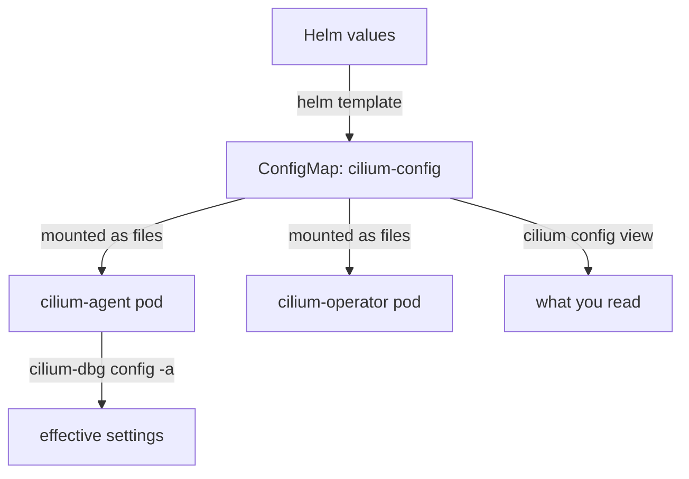

# Where The Configuration Lives

Before you change anything in a Cilium installation, you need to know where its settings are stored and which copy a running component actually reads. This part follows one setting from the Helm values that were used at install time to the ConfigMap that the agents mount, and then reads the whole configuration with the `cilium` command-line tool.

## Four places that hold configuration

Cilium is installed from a Helm chart. Helm (the package manager for Kubernetes) takes a chart, which is a set of templates, and a set of values, and renders them into Kubernetes objects. The `cilium` command-line tool does the same through the Helm library: `cilium install` creates a Helm release named `cilium` in the `kube-system` namespace.

The chart renders a ConfigMap named `cilium-config`. A ConfigMap is a Kubernetes object that holds key and value pairs. The agent pods and the operator pod mount it as files, one file per key. When an agent starts, it reads these files and uses them as its settings.



The diagram shows that two different commands read two different places. `cilium config view` reads the ConfigMap through the Kubernetes API. `cilium-dbg config -a`, which you run inside an agent pod, reads what that agent holds in memory. This part stays with the ConfigMap and the Helm values.

## Reading the ConfigMap with cilium config view

Run the command in the playground:

<!-- astrona:playground:renew -->

```sh
cilium config view
```

The command prints every key and value of the ConfigMap `cilium-config`, one pair per line. It does not talk to an agent. It needs only access to the Kubernetes API and permission to read that ConfigMap in the namespace where Cilium runs.

The list is long, because the chart renders a key for every setting that the agent knows. To find one setting, filter the output with `grep`:

```sh
cilium config view | grep -E '^(ipam|enable-policy|tunnel-protocol|routing-mode|debug) '
```

The pattern works because each line starts with the key. If you are not sure about the key name, search with a shorter word, for example `grep tunnel`. You can also read the same ConfigMap with `kubectl`, and the values are identical:

```sh
kubectl -n kube-system get configmap cilium-config -o yaml
```

The `cilium` tool adds nothing to the data. Its advantage is that it uses the namespace and Helm release options that you set once for every `cilium` command. The `kubectl` form is useful when `cilium` is not installed on the machine you are working on.

## From a Helm value to a ConfigMap key

A Helm value has a nested name such as `ipam.mode`. The ConfigMap key has a different, flat name such as `ipam`. The chart templates decide the mapping, and there is no rule that you can apply without looking. These mappings were checked by rendering the 1.20.3 chart with `helm template`:

| Helm value | ConfigMap key | Meaning |
| --- | --- | --- |
| `ipam.mode` | `ipam` | How pod addresses are allocated |
| `policyEnforcementMode` | `enable-policy` | When network policy is enforced: `default`, `always` or `never` |
| `debug.enabled` | `debug` | Debug logging in the agent |
| `tunnelProtocol` | `tunnel-protocol` | The encapsulation protocol: `vxlan` or `geneve` |
| `routingMode` | `routing-mode` | `tunnel` or `native` |
| `kubeProxyReplacement` | `kube-proxy-replacement` | Whether Cilium replaces `kube-proxy` |
| `hubble.enabled` | `enable-hubble` | Whether the agent runs the Hubble observability server |

Some values do not become a ConfigMap key at all. `operator.replicas` changes the replica count of the Deployment `cilium-operator`, and `hubble.relay.enabled` adds the Deployment `hubble-relay`. A setting that you cannot find in `cilium config view` may therefore live in the spec of a workload object instead.

In the playground, the installation used `--set policyEnforcementMode=never` and `--set tunnelProtocol=geneve`. Look at the two keys:

```sh
cilium config view | grep -E '^(enable-policy|tunnel-protocol) '
```

The line for `enable-policy` shows `never`, and the line for `tunnel-protocol` shows `geneve`. Without the two options, the chart would render `default` and `vxlan`. The ConfigMap therefore records the values that the installation asked for, in the chart's own key names.

## Reading the Helm values

The Helm release stores the values that the installer passed. Read them with Helm:

```sh
helm get values cilium -n kube-system
```

The output lists only the values that differ from the chart defaults, because Helm keeps the user-supplied values separately from the defaults of the chart. To see the merged set, including the defaults, add the flag `--all`:

```sh
helm get values cilium -n kube-system --all
```

Compare the short output with the ConfigMap. The value `policyEnforcementMode: never` appears in the Helm values, and the key `enable-policy` appears in the ConfigMap with the same meaning. Helm values are the better source when you want to know what a person decided at install time. The ConfigMap is the better source when you want to know what the agents will read next time they start.

## The two can differ

The Helm values and the ConfigMap agree after an install or an upgrade, because the chart renders one from the other. They stop agreeing when someone edits the ConfigMap directly, with `kubectl edit` or with `cilium config set`. Helm does not notice the edit. The values that Helm stores stay the same, and the ConfigMap now holds a value that no Helm value produced.

Remember the consequence for reading: a value in the ConfigMap is not proof that the Helm values contain it. If the two disagree, the ConfigMap is what the agents read at their next start, and the Helm values are what a later `helm upgrade` may write back over it.

## What you know and what is open

You can now read the configuration in two places and map a Helm value to a ConfigMap key. You know that `cilium config view` reads the ConfigMap only, and that the ConfigMap is a rendered copy of the Helm values unless somebody edited it. What is still open is whether a running agent uses the value that the ConfigMap holds. The answer depends on when the agent last started.

## Common pitfalls

> [!WARNING]
> - **Searching for the Helm name in the ConfigMap.** `ipam.mode` is not a key in `cilium-config`; the key is `ipam`. Use the mapping table or search with a short word.
> - **Reading only `helm get values`.** It lists the user-supplied values, not the defaults. An empty or short list does not mean that the settings are empty.
> - **Treating the ConfigMap as the running state.** `cilium config view` reads a Kubernetes object. It says nothing about what an agent loaded.
> - **Looking for every setting in the ConfigMap.** Replica counts and optional components such as Hubble Relay are workload objects, not ConfigMap keys.
> - **Forgetting the namespace.** The tool uses `kube-system` by default. An installation in another namespace needs the namespace option, or the command finds no ConfigMap.
