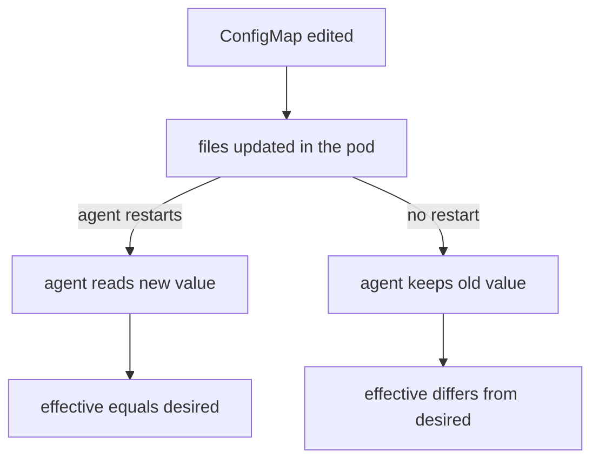

# Effective State And Features

A value in the `cilium-config` ConfigMap is a request, not a fact about the datapath. The agent copies the values into memory when it starts, and it does not read the ConfigMap again for most settings. This part shows how to ask a running agent what it uses, how to read the versions of the client and the installation, and how to read the list of features that the agents report.

## Why the ConfigMap is not the final word

A DaemonSet runs one agent pod on every node. Each pod mounts the ConfigMap `cilium-config` when it is created. The kubelet (the Kubernetes agent on each node) keeps the mounted files up to date when the ConfigMap changes, but the agent process reads its settings from them at start. A change to the ConfigMap therefore reaches an agent only after that agent restarts.

This leads to two states for every setting. The desired state is the ConfigMap value. The effective state is what the agent process holds. They are equal after a restart and can differ before one. A third difference exists between nodes: an agent that started before an edit and an agent that started after it hold different values at the same time.



The diagram shows the decision that matters: a restart makes the agent read the files again. A tool that changes the ConfigMap without a restart leaves the agents with the old values, and a tool that restarts the agents makes them equal to the ConfigMap.

## Asking one agent for its configuration

The agent has its own command-line tool, `cilium-dbg`, that is part of the agent image. It talks to the agent process over a local socket inside the pod. You reach it with `kubectl exec`. Run it against the DaemonSet, and `kubectl` picks one pod:

<!-- astrona:playground:renew -->

```sh
kubectl -n kube-system exec ds/cilium -- cilium-dbg config -a
```

The command prints the configuration options of that agent. The flag `-a` includes options that have their default value; without it the output lists a shorter set. Look for the debug and policy settings in the output:

```sh
kubectl -n kube-system exec ds/cilium -- cilium-dbg config -a | grep -iE 'debug|policyenforcement'
```

The names in this output are the names that the agent uses internally. They are not the ConfigMap keys, so a search for `enable-policy` finds nothing. Compare the meaning, not the text: the key `debug` in the ConfigMap and the option that contains `Debug` in the agent output describe the same setting.

The command reads one pod. If you want the value on a specific node, select the pod on that node and run the same command in it:

```sh
kubectl -n kube-system get pods -l k8s-app=cilium -o wide
kubectl -n kube-system exec <agent-pod-name> -- cilium-dbg config -a
```

Replace `<agent-pod-name>` with a pod name from the first command. The `-o wide` column `NODE` tells you which node each pod runs on.

## The agent status

The same tool shows the health of the agent and what it has set up:

```sh
kubectl -n kube-system exec ds/cilium -- cilium-dbg status --verbose
```

The output is a list of sections. It reports the state of the Kubernetes connection, the IP address management (IPAM) state, the datapath mode, the proxy, the controllers that run inside the agent, and the health of the connection to the other nodes. The text and the sections differ between Cilium releases, so read the sections that belong to the question you have, and do not look for a fixed layout.

Two sections help with the effective state. The one for IPAM shows how addresses are allocated on this node, which you can compare with the `ipam` key. The one for the datapath shows the mode, which you can compare with `routing-mode` and `tunnel-protocol`. An agent that reports a different mode than the ConfigMap holds is an agent that started before the ConfigMap changed.

## Versions

The `cilium` tool and the installation have separate versions, and they can differ. Ask for both:

```sh
cilium version
```

The command shows the version of the client, which is the `cilium` binary on your machine, the Cilium versions that this client installs by default and knows as stable, and the Cilium version that runs in the cluster. To show only the client, add `--client`; this needs no cluster:

```sh
cilium version --client
```

The version of the installation is also in the agent image. Read the image of the agent container:

```sh
kubectl -n kube-system get daemonset cilium -o jsonpath='{.spec.template.spec.containers[?(@.name=="cilium-agent")].image}'
```

The image has the form `quay.io/cilium/cilium:v1.20.3@sha256:...`: a repository, a version tag and an image digest. The tag tells you the release, and the digest pins the exact image. During an upgrade, agents on different nodes can run different versions for a short time, because the DaemonSet replaces pods one at a time.

## The feature report

Cilium has many optional features: Hubble, encryption, the kube-proxy replacement, the Envoy proxy, the Gateway API, and others. The feature report shows which of them are enabled on every node:

```sh
cilium features status
```

The command asks every agent and the operator, and prints one row per feature with the state per node. The default format is a table. Other formats are `markdown` and `json`, selected with `-o`, and `--output-file` writes the result to a file instead of the terminal. Use `json` when a script must read the result:

```sh
cilium features status -o json --output-file features.json
```

Use `--node <name>` to ask only one node. The report is a good first look at an unfamiliar cluster, because it answers "is this feature on?" without a search through the Helm values. It does not tell you why a feature is on or who turned it on. For that, go back to the Helm values and the ConfigMap.

## A worked comparison

Suppose a colleague says: "Debug logging is on." You do not need to trust the sentence. Check the three places in order. Read the ConfigMap key with `cilium config view | grep '^debug '`. Read the Helm value with `helm get values cilium -n kube-system --all` and look for `debug`. Read the agent with `cilium-dbg config -a` and look for the debug option. If the ConfigMap says `true` and the agent says `false`, the agent did not restart after the change. If the Helm value says `false` and the ConfigMap says `true`, someone edited the ConfigMap, and a later `helm upgrade` can turn debug off again.

## What you know and what is open

You can now tell the desired state from the effective state, read the second from one agent, read the client and server versions and list the enabled features. The open question is how the `cilium` command finds the cluster, the namespace and the release to ask these questions, and what to collect when the answers must go to someone else.

## Common pitfalls

> [!WARNING]
> - **Reading one agent and calling it the cluster.** `exec ds/cilium` picks one pod. Agents on other nodes can hold other values after a partial restart.
> - **Searching the agent output for ConfigMap keys.** The agent uses its own option names. Compare the meaning, not the text.
> - **Trusting the client version.** `cilium version --client` says nothing about the cluster. Read the server version or the agent image.
> - **Forgetting `-a`.** Without it, `cilium-dbg config` leaves out options that have their default value.
> - **Reading the feature report as the cause.** It shows that a feature is enabled, not which setting enabled it.
