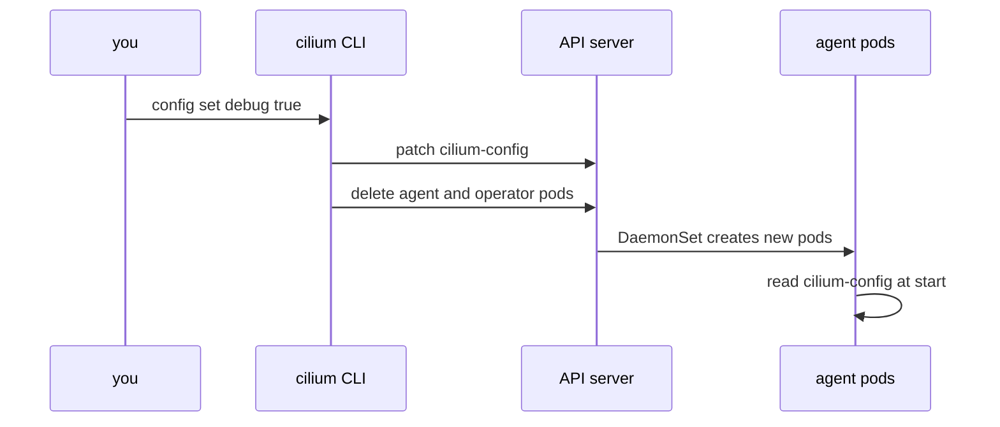

# What cilium config set Does

When you run `cilium config set debug true`, three different things happen in a fixed order, and each of them can go wrong in its own way. This part follows the command from your terminal to the running agents. It shows what the tool sends to the Kubernetes API, what restarts, and how you prove that the new value is active.

## The command in one line

The syntax has two arguments, the key and the value. The key is a key of the ConfigMap `cilium-config`, not a Helm value name:

```sh
cilium config set <key> <value>
```

The tool does not check whether the key exists or whether the value makes sense for it. It sends the text that you typed. A key that the agent does not know is stored in the ConfigMap and then ignored or rejected by the agent when it starts, depending on the key. Check the key name in the output of `cilium config view` before you set it.

## Step 1: a patch to the ConfigMap

The tool builds a patch for the ConfigMap `cilium-config` in the Cilium namespace and sends it to the API server. A patch is a request that changes only some fields of an object. The type used here is a strategic merge patch, which merges the new key into the `data` field of the ConfigMap and leaves every other key as it is.

The tool builds the patch text by joining the key and the value into a JSON string. It does not escape special characters. A value that contains a double quote or a backslash can therefore produce a patch that the API server rejects. Most Cilium values are simple words, numbers or lists without quotes, so this limit rarely matters, but it explains an error such as "invalid character" when you set a complicated value.

The patch changes only the ConfigMap. Nothing else in the cluster knows about it yet. The agents run on, with the values that they loaded at their start.

## Step 2: the restart

Without a restart the new value would not reach the agents. By default, the tool therefore deletes the Cilium agent pods and the Cilium operator pod right after the patch. The option for this is `--restart`, and its default is `true`. The tool does not wait for the new pods to be ready; it returns as soon as the delete requests are accepted.

The DaemonSet `cilium` and the Deployment `cilium-operator` create replacement pods at once. A new agent pod reads the ConfigMap files when it starts, so it uses the new value.



The diagram shows two requests from the tool and no direct contact with the agents. The CLI never talks to an agent. The DaemonSet controller and the kubelet do the restart.

All agent pods are deleted in one step. This differs from a rolling restart, where one node after another is restarted. While the new agent on a node starts, that node has no running agent. Cilium is built so that the datapath, which is the set of BPF programs and maps that forward packets, stays loaded in the kernel while the agent is down, so existing connections continue. Pods that start on a node during that time wait for the agent, because the agent creates their network setup.

## Step 3: you wait and verify

Because the command returns early, the change is not complete when the prompt comes back. Run the change in the playground and watch the pods:

<!-- astrona:playground:renew -->

```sh
cilium config set debug true
kubectl -n kube-system get pods -l k8s-app=cilium
```

The pods that the command deleted show as terminating, and new pods show a status that is not yet ready. Wait for the rollout to finish. A DaemonSet reports a finished rollout when every pod is updated and ready:

```sh
kubectl -n kube-system rollout status daemonset/cilium
cilium status --wait
```

The first command watches the DaemonSet until its pods are ready. The second waits until `cilium status` reports no errors and no warnings. Use both: the first proves that the pods are new, and the second proves that Cilium works.

Then prove that the value is active in two places. First, the ConfigMap:

```sh
cilium config view | grep '^debug '
```

Second, an agent. The agent shows the debug state in its own configuration output:

```sh
kubectl -n kube-system exec ds/cilium -- cilium-dbg config -a | grep -i debug
```

The ConfigMap shows `true`. The agent output must show the debug option as enabled. If the ConfigMap shows `true` and the agent does not, the pod you asked is an old pod, and you should look at the pod ages in the first command.

## Why a pod age is the best proof

A pod age answers the question "was this agent started after the change?" without any knowledge of the setting. The column `AGE` of `kubectl get pods` shows how long a pod has run. If every agent pod is younger than the moment of the change, every agent loaded the ConfigMap after it. This check works for every key, even one whose agent option name you do not know. A script can do the same with the pod creation time, which is the field `metadata.creationTimestamp`.

## Setting values that are not simple words

Most keys take one word, such as `true`, `vxlan` or `kubernetes`. Some take a number, such as a map size. Some take a list inside one string, for example several items separated by commas. Quote the value for your shell, and keep it free of double quotes and backslashes because of the missing escape step. If you need a value that contains them, put the setting in the Helm values instead and run an upgrade; Helm handles the quoting for you.

## What you know and what is open

You can now run `cilium config set`, say what it does in order, and prove that every agent runs with the new value. The open questions are how to remove a key, how to avoid a restart for every single setting when you must change several, and what happens to the edit at the next upgrade.

## Common pitfalls

> [!WARNING]
> - **Reading the prompt as success.** The command returns when the delete requests are accepted, not when the new agents are ready.
> - **Verifying only the ConfigMap.** It shows the new value as soon as the patch is applied. Only the pod age and the agent output show that the agents use it.
> - **Using a Helm value name as the key.** `cilium config set ipam.mode kubernetes` creates a useless key. The key is `ipam`.
> - **Putting quotes in the value.** The tool does not escape them, and the patch can be rejected.
> - **Setting a key you did not check.** The tool accepts any key. A wrong spelling creates a new key and changes nothing.
