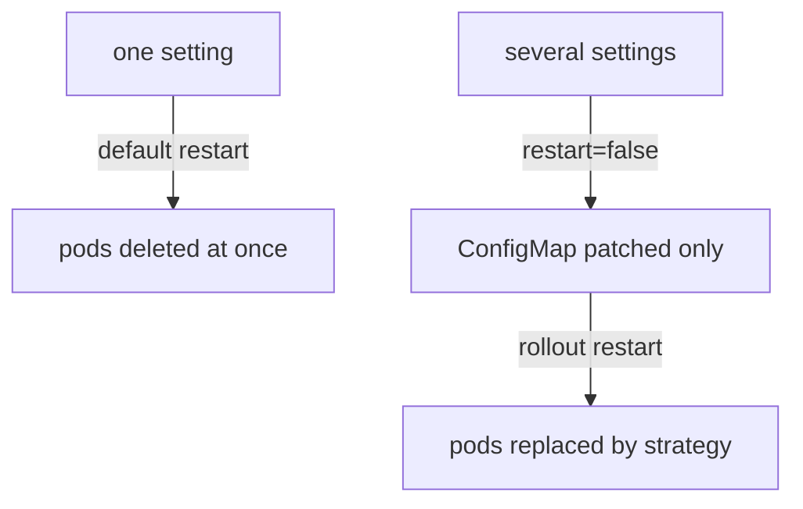

# Deleting Keys And Controlling The Restart

A key in the ConfigMap is not always something you want to keep. Sometimes you set a key to test a fix and want to go back to the state before it. Sometimes you must change four settings, and a restart of every Cilium pod after each one is a waste. This part covers the command that removes a key, the flag that moves the restart under your control, and the commands that restart the pods in the way you choose.

## Removing a key with cilium config delete

The command `cilium config delete` takes one argument, the key:

```sh
cilium config delete <key>
```

It does not send a strategic merge patch like `config set`. It sends a JSON patch, a list of operations on a path, with one `remove` operation for the path of the key inside the `data` field of the ConfigMap `cilium-config`. The API server applies the patch and the key is gone from the ConfigMap. A `remove` on a path that does not exist is an error, so deleting a key that is not there fails instead of doing nothing.

Like `config set`, the command restarts the agent and operator pods by default and returns without waiting. The option `--restart` has the same name and the same default:

<!-- astrona:playground:renew -->

```sh
cilium config set debug true
cilium config delete debug
kubectl -n kube-system get pods -l k8s-app=cilium
```

The second command removes the key that the first one set. The ConfigMap does not hold the key `debug` any more, and the agents restart a second time.

## What the agent does without the key

An agent that starts without a key does not fail. It uses the default value that is built into the agent for that option. This default can differ from the value that the Helm chart renders. The chart renders an explicit value for many keys, for example `debug: "false"`, and the agent's built-in default is the same in that case. For other keys, the chart renders a value that is not the built-in default, and deleting the key changes the behaviour to the built-in value.

Two consequences follow. First, `cilium config delete` is not guaranteed to bring back the state before your change. It brings back the state of an agent that has no value for that key. Second, if you want to return exactly to the chart value, set the key to that value, or run an upgrade that renders the key again.

Check what the chart rendered for a key before you delete it. The Helm values and the chart defaults tell you whether the key existed before your edit:

```sh
helm get values cilium -n kube-system --all | grep -i debug
```

If the key was rendered by the chart, deleting it changes the agent to the built-in default. If you created the key yourself with `config set`, deleting it returns to the state before.

## Several changes, one restart

Every `config set` restarts all the Cilium pods. Four changes in a row give four restarts, and the later commands patch the ConfigMap while the pods of the first restart are still starting. The result is correct, because the last pods read the final ConfigMap, but the cluster does several restarts for nothing.

The flag `--restart=false` stops the tool from deleting the pods. It only patches the ConfigMap:

```sh
cilium config set debug true --restart=false
cilium config set monitor-aggregation maximum --restart=false
```

The two commands change the ConfigMap and do not touch a pod. The agents run on with the old values. The ConfigMap now holds the desired state and the agents hold an older effective state. You must restart the pods yourself to close the gap.

## Restarting the pods yourself

A rollout restart replaces the pods of a DaemonSet or a Deployment by the update strategy of the workload. You control the order and the speed, and the command waits for the result:

```sh
kubectl -n kube-system rollout restart daemonset/cilium
kubectl -n kube-system rollout restart deployment/cilium-operator
kubectl -n kube-system rollout status daemonset/cilium
kubectl -n kube-system rollout status deployment/cilium-operator
```

The restart of the DaemonSet follows its update strategy. In the chart for version 1.20.3 the DaemonSet `cilium` uses `RollingUpdate` with `maxUnavailable: 2`, so up to two nodes can have no agent at the same time. On a cluster with many nodes this is a rolling restart. In the two-node playground it restarts both agents together, which looks like the default restart of the CLI. The operator Deployment uses `maxUnavailable: 100%` with one replica, so it also replaces its pod at once.

You can set a smaller `maxUnavailable` through the Helm values when the cluster is large and a slow, careful restart matters. This is a Helm change, not a ConfigMap change.

## Which restart to choose

The default restart is the best choice for one setting on a test cluster. It is one command, and the effect is the same as a rollout restart on a small cluster. Use `--restart=false` followed by your own rollout when you change more than one setting, or when you want to watch the rollout with `rollout status` and see its failure message.



The diagram shows two ways to the same result: running agents that hold the new values. The second way costs two more commands and gives control over the order.

## Proving the final state

After any restart, check three things. Read the ConfigMap with `cilium config view`. Read the age of the agent pods with `kubectl -n kube-system get pods -l k8s-app=cilium`. Read the agent output with `cilium-dbg config -a` for the settings that the agent shows. If the ConfigMap holds a value and an agent pod is older than the change, that pod does not use it. Delete only that pod, and the DaemonSet creates a new one:

```sh
kubectl -n kube-system delete pod <old-agent-pod>
```

Replace `<old-agent-pod>` with the name of the old pod from the listing. A single pod delete restarts one agent and leaves the others as they are.

## What you know and what is open

You can now remove a key, hold the restart back with `--restart=false`, and restart the pods with `kubectl` in the way that suits the cluster. The open question is where a change belongs. A change that you make with `cilium config` lives in the ConfigMap only. Whoever runs the next Helm upgrade decides what happens to it.

## Common pitfalls

> [!WARNING]
> - **Deleting a key and expecting the chart value.** A deleted key means the built-in default of the agent, which can differ from the chart.
> - **Deleting a key that is not there.** The JSON patch fails. Check the key with `cilium config view` first.
> - **Using `--restart=false` and forgetting the restart.** The ConfigMap shows the new value and the agents run the old one. Nothing fails, and nothing changes.
> - **Restarting the DaemonSet and not the operator.** Operator settings are read by the operator. A change for the operator needs a new operator pod.
> - **Running `config set` again while the first rollout is still starting.** The cluster restarts twice. Wait for `rollout status` between changes, or batch them.
