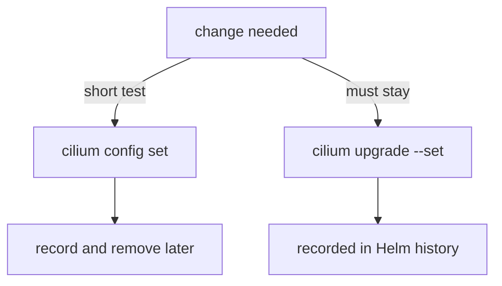

# Who Owns The Setting

A setting in the `cilium-config` ConfigMap has two possible owners. One is the person who ran `cilium config set`. The other is Helm, which rendered the ConfigMap from the values of the release. When both exist, the next Helm operation can change what the person did. This part explains how Helm treats a ConfigMap that someone edited, how to carry a change through an upgrade, and how to decide where a change belongs.

## Two ways to change the same key

A change through the CLI edits the live ConfigMap. The Helm release does not know about it. Its stored values and its stored manifest are the same as before. Look at the release after an edit:

<!-- astrona:playground:renew -->

```sh
cilium config set debug true
helm get values cilium -n kube-system
helm history cilium -n kube-system
```

The Helm values do not mention `debug`, and the release history shows no new revision. The change exists only in the cluster. A Helm revision is created only by Helm operations such as `helm upgrade`, `helm rollback` and `cilium upgrade`.

A change through Helm edits the values of the release and renders the ConfigMap again. The equivalent of the command above, written as a value, is `debug.enabled=true`. A change like this is recorded in the release history, can be rolled back with `helm rollback`, and is part of the values that the next upgrade starts from.

## What an upgrade does to a manual edit

Helm compares three things during an upgrade: the manifest of the old release, the manifest of the new release, and the live object in the cluster. It builds a patch from the difference between the old and the new manifest and applies it to the live object. A field that is the same in the old and the new manifest produces no patch for that field, so the live value stays, even when a person changed it by hand. A field whose rendered value changes between the old and the new manifest is patched to the new value.

The result depends on the upgrade, not only on your edit:

- If the upgrade does not change the rendered value of the key that you edited, the edit can survive.
- If the upgrade changes the value of that key, for example because the new chart version has a different default or because you changed the matching Helm value, the edit is overwritten.
- A rollback to an older revision patches the object by the same rules and can change the key back.

You cannot see from the edit alone which case applies, and a later change in the chart can move an edit from the first case to the second. For this reason, treat a CLI edit as a temporary or experimental change. The edit that must survive belongs in the Helm values.

## Carrying a change through an upgrade

To make a change permanent, put it in the Helm values and run an upgrade. The `cilium upgrade` command does this through the same Helm library as the installation. It takes the same `--set`, `--set-string`, `--set-file` and `--values` flags as `cilium install`. By default, it uses `--reset-then-reuse-values`: it starts from the chart defaults, applies the values of the last release, and merges your command-line overrides on top. The Helm values that were used before are therefore kept, and your new value is added:

```sh
cilium upgrade --version 1.20.3 --set debug.enabled=true --wait
```

The option `--version 1.20.3` keeps the same Cilium version. Without it, the command upgrades to the default version of your `cilium` client, which may be newer. Two related options change how old values are treated. `--reuse-values` reuses the values of the last release and takes precedence over the default. `--reset-values` uses the chart defaults only and drops the old values. Neither is what you want for a one-value change, and `--reset-values` removes the options that the installation was started with.

Check the effect after the upgrade. The release now has a new revision, and the value is in the user-supplied values:

```sh
helm history cilium -n kube-system
helm get values cilium -n kube-system
cilium config view | grep '^debug '
```

The history shows a second revision. The values include `debug: enabled: true`, and the ConfigMap shows `true`. A Helm upgrade restarts the agents if the pod template changes; a ConfigMap-only change in the manifest does not by itself restart pods, so check the pod age after the upgrade.

## Reading what you can learn before an upgrade

You can see what an upgrade would do without doing it. The flags `--dry-run` and `--dry-run-helm-values` exist for both install and upgrade. The first writes the resources that would be installed. The second prints only the values that differ from the chart defaults:

```sh
cilium upgrade --version 1.20.3 --set debug.enabled=true --dry-run-helm-values
```

The output shows the values that the upgrade would store. Read it before you run the upgrade. If a value from the earlier installation is missing in the output, the upgrade would drop it. With the default `--reset-then-reuse-values`, it keeps the earlier values.

## Deciding where a change belongs

Use these rules in practice:

- A test or a short debugging session: use `cilium config set`. Remove the change with `cilium config delete` or an upgrade when you are done, and write down that you made it.
- A setting that the cluster must keep: change the Helm values with `cilium upgrade`, so the release records it and an upgrade cannot undo it unknowingly.
- A setting that exists only in the ConfigMap and that you find on a cluster: ask whether anyone knows why. If not, it is an undocumented change, and it should move into the Helm values or be removed.



The diagram shows that the two ways differ in what they leave behind. The CLI edit leaves a ConfigMap value that only the cluster knows. The upgrade leaves a Helm revision that the history records.

## Finding edits that Helm does not know

A difference between the Helm values and the ConfigMap is a sign of a manual edit. You can search for it by rendering the chart with the stored values and comparing the result with the live ConfigMap. The command `helm get manifest cilium -n kube-system` prints the manifest of the current revision, including the ConfigMap as Helm rendered it:

```sh
helm get manifest cilium -n kube-system | grep -E '^  (debug|monitor-aggregation):'
cilium config view | grep -E '^(debug|monitor-aggregation) '
```

If the two outputs hold different values for the same key, somebody edited the live object after the release was made. The manifest is the rendered text that Helm stored, and the live ConfigMap is what the agents read.

## What you know

You can now say who owns a setting, show whether a change is recorded by Helm, run an upgrade that carries a change, and find a manual edit by comparing the stored manifest with the live ConfigMap. The practical rule is short: edit by hand to learn, change the Helm values to keep.

## Common pitfalls

> [!WARNING]
> - **Assuming a CLI edit is permanent.** An upgrade that changes the same key overwrites it, and you cannot see this in advance.
> - **Running `cilium upgrade` without `--version`.** The command moves to the default version of your client. State the version you want.
> - **Using `--reset-values` to change one value.** It drops every value of the old release, including options from the installation.
> - **Believing that no revision means no change.** A ConfigMap edit leaves the Helm history untouched, so an empty history tells you nothing about manual edits.
> - **Skipping `--dry-run-helm-values`.** It shows what the upgrade would store, and it costs one command.
