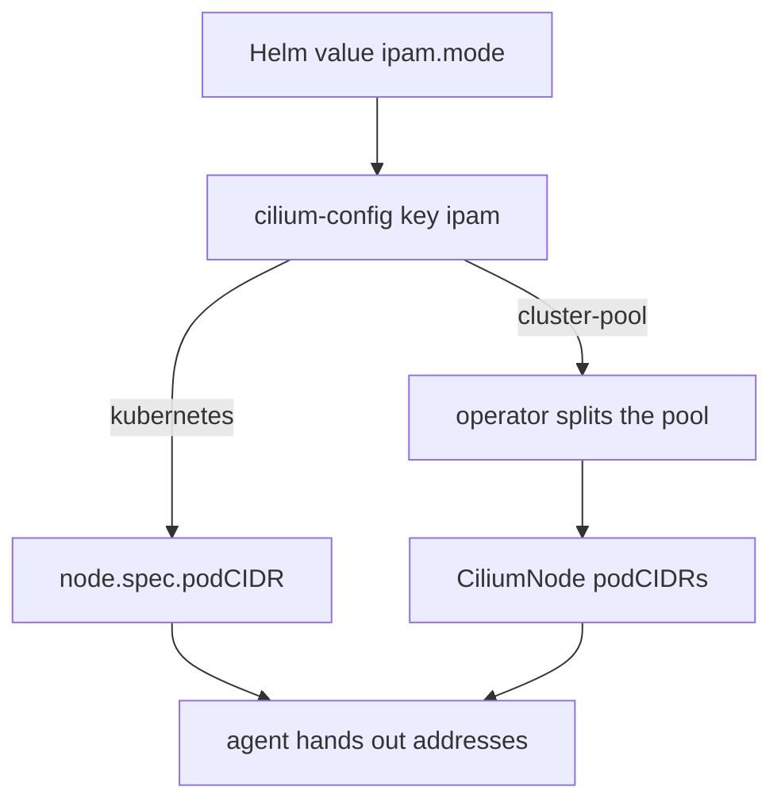

# IPAM Modes

Every pod needs an IP address, and something has to decide which node gets which range of addresses. In Cilium this is called IP address management (IPAM). The IPAM mode is the first setting you read in an unknown cluster, because it decides which component allocates the ranges and where you must look when a pod gets no address.

## The key and the Helm value

The agents read the mode from the key `ipam` of the ConfigMap `cilium-config`. The Helm value that renders it is `ipam.mode`. Read the key with the Cilium command-line tool:

<!-- astrona:playground:renew -->

```sh
cilium config view | grep -E '^ipam '
```

The playground prints `cluster-pool`. The chart default is also `cluster-pool`. Other values exist for cloud providers (`eni` for Amazon Web Services, `azure`, `alibabacloud`), for the `crd` mode, in which you write the ranges yourself in the `CiliumNode` resources, and for `multi-pool`, which can give one node ranges from several named pools.

## Cluster pool mode

In cluster pool mode the Cilium operator owns the ranges. It splits a cluster-wide range into one smaller range for each node and writes the result into the `CiliumNode` resource of that node. The agent on the node then hands out single addresses from its range. The cluster-wide range comes from the Helm value `ipam.operator.clusterPoolIPv4PodCIDRList`. The size of each node range comes from `ipam.operator.clusterPoolIPv4MaskSize`, which is 24 by default.

Read the ranges the operator assigned:

```sh
kubectl get ciliumnodes -o custom-columns=NAME:.metadata.name,CIDRS:.spec.ipam.podCIDRs
```

Each node has its own range. A pod on that node gets its address from the range, and the agent adds a route for it.

## Kubernetes mode

In `kubernetes` mode Cilium does not allocate ranges. It reads the range that Kubernetes already assigned to each node in `node.spec.podCIDR`. The Kubernetes controller manager allocates those ranges from the cluster CIDR that was given when the cluster was created. This mode is the right choice when the cluster already has a pod range that other tools depend on.

```sh
kubectl get nodes -o custom-columns=NAME:.metadata.name,CIDR:.spec.podCIDR
```

In the playground this column shows the ranges of the `kind` cluster, but Cilium does not use them, because the mode is `cluster-pool`. Compare the two lists: the ranges are different. That difference is the quickest way to learn which mode a cluster uses.



The diagram shows that both modes end at the agent. They differ in who creates the node range.

## Reading the mode from an agent

The configuration file is not the only evidence. Ask an agent what it uses:

```sh
kubectl -n kube-system exec ds/cilium -- cilium-dbg status --verbose
```

The output has an IPAM section. It states how many addresses the node has allocated out of its range. When a pod stays in the state `ContainerCreating` and the events say that no IP address is available, this section shows that the range of the node is full.

## Changing the mode

Do not change the IPAM mode on a running cluster as a routine step. Pods that already have an address keep it, but the ranges, the routes and the operator behaviour change underneath them. The usual path is to choose the mode when you install Cilium and to build a new cluster or a new node pool when you must move to another mode. If you must change the node range size, plan the change as a maintenance task and read the upgrade notes for your version first.

## What you know and what is open

You can now read the IPAM mode, say who allocates the ranges in the two common modes, and find the ranges of every node. The open question is how packets move between those ranges when the pods are on different nodes. That is the job of the routing mode.

## Common pitfalls

> [!WARNING]
> - **Mixing up the Helm value and the key.** The Helm value is `ipam.mode`. The `cilium-config` key is `ipam`.
> - **Reading `node.spec.podCIDR` and assuming Cilium uses it.** In cluster pool mode Cilium uses the `CiliumNode` ranges.
> - **Changing the mode on a live cluster without a plan.** Existing pods keep their addresses, and the ranges underneath them change.
> - **Using a cluster range that overlaps with the node network or the service range.** Routing then fails in ways that look random.
