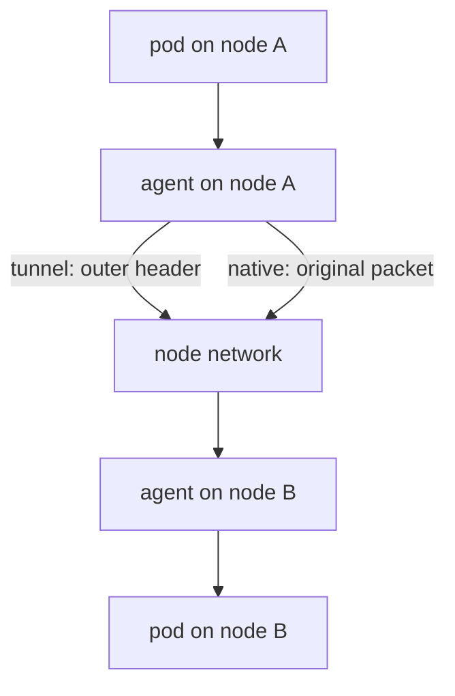

# Routing Mode And Tunnels

When a pod on one node sends a packet to a pod on another node, something has to carry that packet across the node network. The routing mode decides how. This part explains the two modes, the keys that control them, and the effect on the maximum packet size. It also shows how to tell which mode a cluster uses.

## Reading the routing settings

Two keys of `cilium-config` describe the choice. The key `routing-mode` is `tunnel` or `native`. The key `tunnel-protocol` is `vxlan` or `geneve` and matters only in tunnel mode:

<!-- astrona:playground:renew -->

```sh
cilium config view | grep -E '^(routing-mode|tunnel-protocol) '
```

The Helm values are `routingMode` and `tunnelProtocol`. The chart default is the tunnel mode with the VXLAN protocol. The playground uses Geneve, so the output differs from a default installation.

## Tunnel mode

In tunnel mode the agent wraps every packet that leaves for another node in a new outer packet. The outer packet goes from the source node to the destination node, over the ordinary node network. The agent on the destination node removes the outer header and delivers the original packet. VXLAN (Virtual Extensible LAN) uses UDP port 8472 in Cilium, and Geneve (Generic Network Virtualization Encapsulation) uses UDP port 6081. The node network must allow that UDP port between all nodes.

The big advantage is that the node network needs to know nothing about pod ranges. Any network that can carry UDP between the nodes works. The cost is the extra header: it takes bytes from every packet, so the largest inner packet is smaller than the largest packet of the node network.

## Native routing mode

In native routing mode the agent sends the packet with its original addresses. The node network itself must know how to reach every pod range. That means one of three things: the nodes share one layer 2 network and Cilium installs routes between them, a cloud provider route table has the ranges, or a routing protocol such as the Border Gateway Protocol (BGP) announces them.

Native routing needs more settings. The Helm value `ipv4NativeRoutingCIDR` tells Cilium which destinations it must not translate and masquerade, and `autoDirectNodeRoutes` tells the agent to install the node-to-node routes when the nodes share a layer 2 network. Without those settings, packets to other nodes are dropped or leave with the wrong source address.



The diagram shows the single difference: in tunnel mode the node network carries a wrapped packet, and in native mode it carries the original packet.

## The effect on MTU

The maximum transmission unit (MTU) is the largest packet a link carries. VXLAN adds about 50 bytes to each packet. Geneve adds at least as much, depending on its options. The agent detects the MTU of the node network and lowers the pod MTU by the overhead of the chosen mode. You can set the value with the Helm value `MTU` when detection is wrong, for example on a network with jumbo frames.

A wrong MTU is a classic cause of one problem: small requests work, and large ones hang. Look at the MTU of the pod interface and of the node interface and compare them:

```sh
kubectl -n starfleet exec deploy/shuttle -- cat /sys/class/net/eth0/mtu
```

## Reading the mode from an agent

The agent reports its datapath mode in the status output. Look for the routing line:

```sh
kubectl -n kube-system exec ds/cilium -- cilium-dbg status --verbose
```

The line names the network mode (tunnel with its protocol, or native). If the ConfigMap and the agent disagree, the agent has not restarted since the change.

## Changing the mode

The routing mode, the tunnel protocol and the MTU are datapath settings. Changing them with `cilium config set` writes the key, but the safe path is a Helm upgrade with the values that belong together, followed by a rolling restart of the agents. During the restart, traffic between nodes can drop for a short time. Change the tunnel protocol on all nodes in one rollout, because a node that uses VXLAN cannot talk to a node that uses Geneve.

## What you know and what is open

You can now read the routing keys, explain the two modes, name the extra settings that native routing needs and see why the MTU matters. The open question is how a Service address reaches a backend pod, which is a separate piece of work in the datapath.

## Common pitfalls

> [!WARNING]
> - **Switching to native routing without `ipv4NativeRoutingCIDR`.** Cilium then masquerades or drops traffic that should flow directly.
> - **Blocking the tunnel port in a firewall.** Same-node traffic works and cross-node traffic does not.
> - **Mixing tunnel protocols between nodes during a change.** Change all nodes in one rollout.
> - **Ignoring the MTU.** Small requests succeed and large responses hang.
