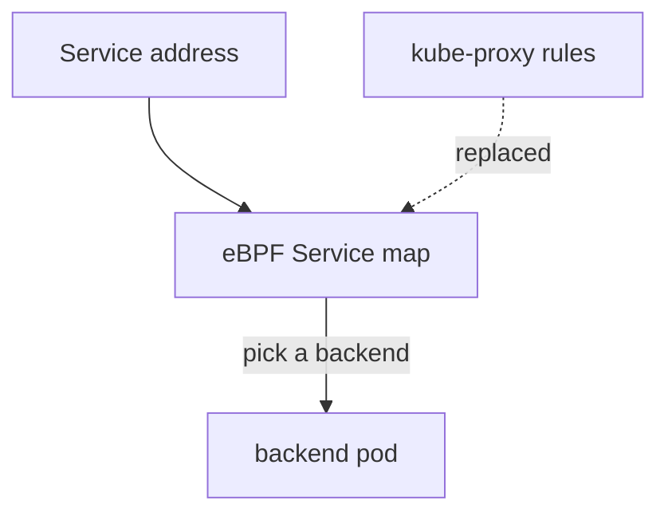

# Kube-Proxy Replacement

A Kubernetes Service gives a set of pods one stable virtual address. Something on every node must turn a connection to that address into a connection to one backend pod. Usually that is `kube-proxy`, which programs iptables or IPVS rules. Cilium can do the same work in eBPF programs, which is called kube-proxy replacement. This part explains what the setting changes, what it needs and how to check it.

## What the setting does

With kube-proxy replacement on, the Cilium agent watches Services and EndpointSlices and writes the Service-to-backend mapping into eBPF maps. The datapath looks up the destination address in those maps and picks a backend. The kernel does not walk a long list of iptables rules, and `kube-proxy` is not needed for Services.

The Helm value is `kubeProxyReplacement`, and the key in `cilium-config` is `kube-proxy-replacement`. Read it:

<!-- astrona:playground:renew -->

```sh
cilium config view | grep -E '^kube-proxy-replacement'
```

The playground keeps the chart default, so `kube-proxy` still runs next to Cilium in the `kind` cluster. Do not read the value alone. Ask the agent what it really does:

```sh
kubectl -n kube-system exec ds/cilium -- cilium-dbg status --verbose
```

The output has a KubeProxyReplacement section. It states whether the feature is on and lists the parts that it covers, such as the handling of NodePort and external addresses. This is the evidence to use, because the agent can fall back or reject a combination.

## The API server address

When `kube-proxy` is gone, there is no Service address for the Kubernetes API server on the node during start. The agent must reach the API server before the Service rules exist. For that reason, a cluster without `kube-proxy` needs two Helm values:

- `k8sServiceHost` is the address or host name of the API server that the agent can reach directly.
- `k8sServicePort` is its port.

If you forget them, the agents cannot start, the nodes stay `NotReady` and `cilium status` shows no ready agents. The fix is to set the two values and upgrade. A cluster that keeps `kube-proxy` does not need them.

## Removing kube-proxy

Turning the replacement on does not remove `kube-proxy`. If both run, both program the node. Remove the old component deliberately. In a cluster built with `kubeadm`, you skip it at creation with the `addon/kube-proxy` phase, or you delete the DaemonSet and clean the old rules afterwards. Clean up before you trust the result, because leftover rules can still match traffic.



The diagram shows that the lookup happens in the Cilium eBPF map and not in the `kube-proxy` rules.

## Checking the Service table

You can read the Service table of an agent. It shows the frontend address and the backends that the agent knows:

```sh
kubectl -n kube-system exec ds/cilium -- cilium-dbg service list
```

A Service with no backends here has no ready pods, or the agent has not yet seen the EndpointSlice. Compare it with `kubectl get endpointslices`.

## What you know and what is open

You can now say what kube-proxy replacement does, which two values a cluster without `kube-proxy` needs, and how to confirm the state from the agent. The open question is how to decide which of all these settings may change on a running cluster, and what the policy enforcement mode does to traffic.

## Common pitfalls

> [!WARNING]
> - **Enabling the replacement and leaving `kube-proxy` running.** Two components then program the same node.
> - **Removing `kube-proxy` without `k8sServiceHost` and `k8sServicePort`.** The agents cannot reach the API server at start.
> - **Trusting the ConfigMap alone.** Read the KubeProxyReplacement section of the agent status.
> - **Forgetting old iptables rules.** Clean them up after you remove `kube-proxy`.
