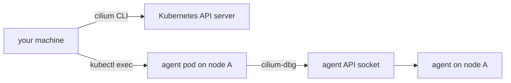

# Reaching The Agent Debug Client

Many Cilium problems cannot be solved from the API server alone. A pod may have a valid Kubernetes object and still have no working network path. To see why, you need the view of the agent on the node where the pod runs. This part explains where that view lives, how to open it and why you must choose the node first.

## Two tools with two jobs

The command `cilium` is the Cilium CLI. It runs on your machine, uses your kubeconfig and calls the Kubernetes API server. It installs Cilium, reads the ConfigMap, runs the connectivity test and reads the status of the workloads.

The command `cilium-dbg` is the debug client of the agent. The agent (a program that runs on each node, loads the BPF programs and keeps the network state of the node) exposes a local API on a Unix socket inside its pod. `cilium-dbg` is a client of that socket. It is installed in the agent container, not on your machine. Before Cilium 1.15 this client was called `cilium` inside the pod, which caused confusion with the CLI. Current releases use the name `cilium-dbg`, and this course uses Cilium 1.20.3.



The diagram shows that `cilium-dbg` never leaves the pod. `kubectl exec` carries your command into the container, and the client talks to the agent over the local socket.

## Running a command in an agent

The agent pods belong to the DaemonSet `cilium` in `kube-system`. The simplest form runs a command in one pod of that DaemonSet:

<!-- astrona:playground:renew -->

```sh
kubectl -n kube-system exec ds/cilium -- cilium-dbg version
```

When you give `ds/cilium`, `kubectl` picks one pod. You do not control which one. That is fine for a command about the whole installation, such as the version, and wrong for a question about a pod on a given node. The agent only knows the pods on its own node, so asking the wrong agent returns a table without the pod you want.

## Choosing the agent for a node

To ask about a pod, first find its node, then find the agent pod on that node. The column `NODE` of the wide output gives both:

```sh
kubectl -n starfleet get pods -l app=probe -o wide
kubectl -n kube-system get pods -l k8s-app=cilium -o wide
```

Match the node name from the first command with the node name in the second, and note the agent pod name. Then run `cilium-dbg` in that pod by name:

```sh
kubectl -n kube-system exec <agent pod> -c cilium-agent -- cilium-dbg status --brief
```

The flag `-c cilium-agent` names the container. The agent pod can hold more than one container, and naming it avoids a default that may change. The command `cilium-dbg status --brief` prints a single word that says whether the agent considers itself healthy.

## Help and discovery

`cilium-dbg` has many subcommands. You do not need to remember them. Run it with `--help` to list the top level, and add a subcommand to list its children:

```sh
kubectl -n kube-system exec ds/cilium -- cilium-dbg --help
kubectl -n kube-system exec ds/cilium -- cilium-dbg endpoint --help
```

The output is longer than a screen, and the exact list changes between releases. Read the group names first: `endpoint`, `identity`, `service`, `policy`, `bpf`, `config`, `status` and `monitor` are the ones this module uses.

## What you know and what is open

You can now explain the difference between the CLI and the debug client, open the debug client in the right agent and discover its subcommands. The open question is what the agent reports about itself and which of its settings you can change from inside.

## Common pitfalls

> [!WARNING]
> - **Running `cilium-dbg` on your machine.** It is installed in the agent container only. Use `kubectl exec`.
> - **Using `ds/cilium` for a node-specific question.** `kubectl` picks any pod. Choose the pod by node.
> - **Confusing the two names.** Before 1.15 the pod client was `cilium`. On 1.20.3 it is `cilium-dbg`.
> - **Reading one agent as the cluster.** Each agent shows only its own node.
