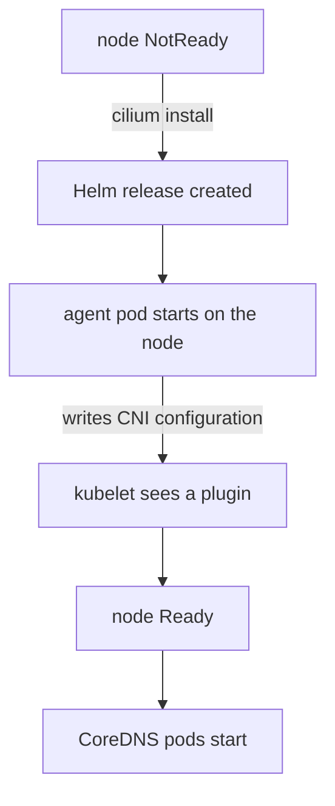

# Prerequisites And What Gets Installed

Before you run `cilium install`, you should know what the cluster must provide and what the installation adds to it. A wrong assumption here shows up later as a pod that never becomes ready, and the message is rarely about the real cause. This part lists the requirements, explains why a cluster without a network plugin looks broken, and names every workload that the chart creates.

## Why the cluster looks broken without a network plugin

Kubernetes does not give pods a network by itself. When the kubelet (the Kubernetes agent on a node) starts a pod, it calls the container runtime, and the runtime calls a network plugin through the Container Network Interface (CNI), the standard interface for network plugins. The plugin gives the pod an IP address and connects it to the network. If no plugin is configured on a node, the kubelet reports the node as `NotReady`, with a message that the network plugin is not ready.

Pods that use the pod network cannot start on such a node. That includes CoreDNS, which provides the cluster DNS (the name lookup for Services). Pods that use the host network do not need a plugin and can run, such as `kube-proxy` and the control-plane components. The cluster therefore looks half alive: the API server answers, and nothing that serves applications runs.



The diagram shows the order. The Cilium agent runs with the host network, so it can start on a `NotReady` node. Its first job is to write the CNI configuration file on the node. After that, the kubelet reports the node as ready, and pods with their own network can start.

## What the cluster must provide

Cilium has requirements for the nodes, the cluster and your machine.

- **Linux kernel 5.10 or newer on every node.** Cilium loads BPF programs into the kernel. These are small programs that run inside the kernel to forward packets and enforce policy. Older kernels lack features that the datapath needs. In a `kind` cluster the nodes are containers that share the kernel of your host, so the host kernel counts.
- **No other network plugin.** Only one plugin owns the CNI configuration of a node. A second plugin conflicts with it. A `kind` cluster that should use Cilium must be created with its default network plugin switched off. The playground does this for you.
- **Access to the container images.** The nodes pull the images from a public registry. A cluster without internet access needs a mirror and an image override in the values.
- **Access to the chart.** The `cilium` tool downloads the Helm chart from the Cilium chart repository when you install, so your machine needs access to it. The option `--repository` points the tool to another repository, and `--chart-directory` uses a chart that is already on disk.
- **Rights to create cluster-wide objects.** The installation creates cluster roles, cluster role bindings and a service account for the agent. Use an identity with cluster administrator rights.
- **Enough resources.** The agent runs on every node with its own memory use. A node that is too small leaves the agent pod in a pending or crash state.

In `kind` on Linux, the many pods of a cluster can reach the limit of inotify watches or file handles of the host. The symptom is an error such as "too many open files" in the pod logs. If you see it, raise the limits `fs.inotify.max_user_watches` and `fs.inotify.max_user_instances` on the host. This is a host setting, not a Cilium setting.

## What the chart creates

The chart is rendered with `helm template` for version 1.20.3. The list of workloads in the default installation is short:

| Kind | Name | What it does |
| --- | --- | --- |
| DaemonSet | `cilium` | The agent on every node. It writes the CNI configuration, loads the BPF programs and enforces policy |
| DaemonSet | `cilium-envoy` | Runs Envoy, the proxy that handles Layer 7 traffic and some Layer 4 features, on every node |
| Deployment | `cilium-operator` | Does the cluster-wide work, such as IP address management for the cluster and cleanup of stale objects |
| ConfigMap | `cilium-config` | The settings that the agent and the operator read |
| Service accounts, roles, bindings | several | The rights that the agent and the operator need on the Kubernetes API |

Optional components appear when you enable them. Hubble, the observability layer, adds more objects, and `hubble.relay.enabled` adds the Deployment `hubble-relay`, which collects the flow data of all agents into one endpoint. The chart does not create custom resource definitions (CRDs, the objects that add new API kinds); the agent and the operator register their CRDs themselves when they start.

The operator runs with two replicas by default and places them on different nodes. On a cluster with one node, the second replica cannot be scheduled. You set one replica with the value `operator.replicas=1`, which the labs of this module use.

## IP address management

When a pod starts, the agent must give it an address. The way it does that is the IP address management (IPAM) mode, set with the Helm value `ipam.mode`, which becomes the ConfigMap key `ipam`. With the mode `kubernetes`, the agent uses the pod CIDR (the address range) that Kubernetes assigned to the node, which comes from the field `spec.podCIDR` of the node object. With the default mode of the chart, `cluster-pool`, the Cilium operator hands out ranges to nodes instead.

A `kind` cluster assigns a pod CIDR to every node, so the mode `kubernetes` works there. The labs set it on purpose, so you see where an installation chooses its address source.

## Checking the cluster before you install

Four commands tell you whether the cluster is ready for the installation. Run them in the playground. The first shows the node state:

<!-- astrona:playground:renew -->

```sh
kubectl get nodes
kubectl -n kube-system get pods
```

The nodes show `NotReady`, and the CoreDNS pods show `Pending`. The kubelet reports the reason on the node. Look at the `Ready` condition in the node description:

```sh
kubectl describe node <node-name> | grep -A2 -i 'ready'
```

Replace `<node-name>` with a name from the first command. The message names the missing network plugin. Then read the kernel version that each node reports. This field comes from the node itself, and in `kind` it is the kernel of your host:

```sh
kubectl get nodes -o jsonpath='{range .items[*]}{.metadata.name}{"  "}{.status.nodeInfo.kernelVersion}{"\n"}{end}'
```

Compare the number with the minimum of 5.10. Last, check the pod CIDR that Kubernetes assigned to each node, which the IPAM mode `kubernetes` uses:

```sh
kubectl get nodes -o jsonpath='{range .items[*]}{.metadata.name}{"  "}{.spec.podCIDR}{"\n"}{end}'
```

A node without a value here cannot use the mode `kubernetes`. Then the cluster must be created with pod CIDR allocation, or you use another IPAM mode. A check of these four facts before the install saves a failed installation and a search in the logs afterwards.

## What you know and what is open

You know why a cluster without a plugin looks broken, what the nodes must provide, and which workloads the chart adds. The open question is the command itself: which version it installs and how you pass the settings.

## Common pitfalls

> [!WARNING]
> - **Installing on top of another network plugin.** Two plugins fight over the CNI configuration of the node. Remove the first, or create the cluster without it.
> - **Forgetting that `kind` shares the host kernel.** A host kernel older than 5.10 breaks the agent, whatever the node image says.
> - **Expecting CoreDNS to work before the agent is ready.** CoreDNS needs the pod network. It starts after the node is ready.
> - **Running the install from an identity without cluster rights.** The chart creates cluster roles. A namespace administrator gets a `Forbidden` error.
> - **Leaving two operator replicas on a one-node cluster.** The second replica stays pending, and the Deployment never reports ready.
