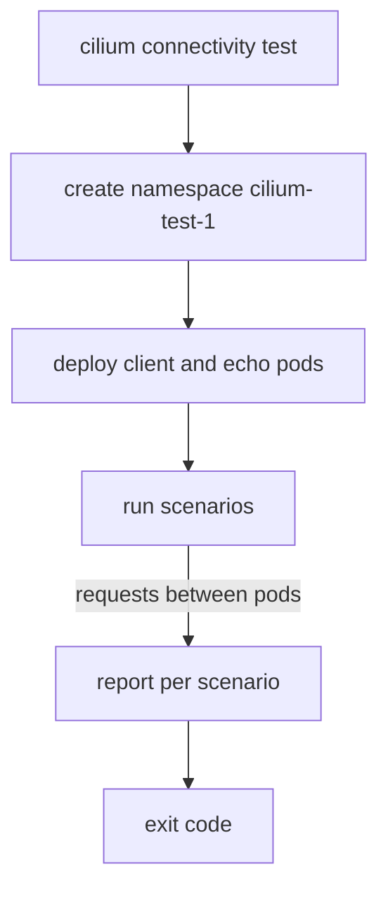

# What The Test Deploys And Checks

The connectivity test differs from `cilium status`. A status command reads the state of objects. The connectivity test acts: it creates pods, sends requests between them and judges the answers. Because it acts, it changes the cluster, takes minutes and can fail for reasons outside Cilium. This part describes what one run creates, what it checks and how it ends.

## What a run creates

When you start the command, the tool first creates a namespace for the test. The default name is `cilium-test`, and the tool always adds a sequence number, so the first namespace is `cilium-test-1`. The sequence number exists because a run can use several namespaces in parallel. In the namespace, the tool deploys a set of test workloads and Services:

- **`client` and `client2`** are pods that send the requests. Two clients make it possible to test policies that allow one client and deny the other.
- **`echo-same-node`** is a server pod on the same node as the clients. It answers HTTP requests with a description of the request that it received.
- **`echo-other-node`** is a server pod on a different node. It exists only when the cluster has more than one node and the run is not limited to a single node.
- Services for the echo servers, and additional workloads for some scenarios, such as a pod that tests Layer 7 load balancing.

The test also reaches targets outside the cluster for some scenarios, by default well-known public addresses and names. Those scenarios need internet access from the nodes. A cluster without it fails them, and the fix is to skip them or to point the test at targets that you control.

## Start a run

Run the full test in the playground. It takes a few minutes, and the tool prints each step as it works:

<!-- astrona:playground:renew -->

```sh
cilium connectivity test
```

The tool first checks that Cilium is running. Then it deploys the test workloads and waits for them to be ready. It runs the scenarios one after the other and prints a line for each. It ends with a count of the actions and scenarios that passed or failed. Read the report from the end: the last lines say how many scenarios ran and how many failed. If all passed, the exit code of the command is zero.

You can check the namespace while the test runs or after it:

```sh
kubectl get namespaces
kubectl -n cilium-test-1 get pods -o wide
```

The pods show the node of each test pod. Compare the nodes of `client` and `echo-other-node`: they differ, because the test wants traffic to cross a node boundary.



The diagram shows the sequence of a run. The `cilium` tool creates every object through the Kubernetes API, and the test pods then send the requests themselves. The tool runs `curl` and similar commands inside the client pods and judges the results.

## What the scenarios test

A scenario is one kind of traffic with an expected result. Some scenarios check that a request works. Others apply a Cilium network policy first and check that a request is denied. Examples of names that you meet in the report are `pod-to-pod`, `pod-to-service`, `pod-to-world` and `pod-to-host`. The names say where the request starts and where it goes: another pod, a Service, the public internet, or the node of the pod.

A scenario contains several actions. An action is one request from one source to one destination, for example one `curl` from `client` to one echo pod on one IP family. The report counts actions, and a scenario fails when one of its actions fails. A scenario like `pod-to-service` tests the Service address and also the backend address, because the Service load balancing is done by Cilium or by `kube-proxy`, depending on the installation.

Scenarios that apply policies change the traffic rules in the test namespace only. They do not touch your own namespaces. This is a reason to keep the test namespace separate from your workloads, and the tool does so by default.

## The exit code

The command ends with an exit code. Zero means that all scenarios passed. A non-zero code means that at least one failed or that the run could not finish. A script or a pipeline step uses the code to decide:

```sh
cilium connectivity test --single-node --test pod-to-pod
echo $?
```

The command line limits the run, and `echo $?` prints the exit code of the previous command. The flag `--exit-zero-on-failure` makes the tool end with zero even when tests fail. Use it only when another step reads the JUnit report and decides, because it hides failures from the shell.

## Why a failed scenario is not always a Cilium fault

The test relies on things outside Cilium. A scenario to a public address fails when the nodes have no internet access. A scenario that needs a specific kernel feature fails on a kernel that lacks it, and the test may skip scenarios for features that the installation does not enable. A pull error for a test image stops the whole run before any scenario starts. Read the failing line, and read the output above it. The tool names the source, the destination and the action that failed.

## Watching a run in more detail

The default output shows one line per step. Two flags make it easier to follow a long run. `--verbose` or `-v` prints informational messages and does not buffer lines, so you see each message when it happens. `--timestamp` or `-t` adds the time to every message, which helps when you compare a failure with the logs of an agent. The flag `--debug` or `-d` adds debug messages of the tool itself:

```sh
cilium connectivity test --single-node --test pod-to-pod --verbose --timestamp
```

Use the plain output for a pass or fail decision and the detailed output when you search for the reason of a failure. The detail is long, so redirect it to a file with `> run.log 2>&1` when you want to read it later.

## What you know and what is open

You can now say what a run creates, what the scenarios do, and how the run ends. The open question is how to make a run small, so it takes seconds and checks one thing, and how to place the test namespace where you want it.

## Common pitfalls

> [!WARNING]
> - **Running the full test on a cluster without internet access.** The scenarios that reach public targets fail, and the failure looks like a datapath fault.
> - **Looking for the test pods in your own namespace.** The test uses its own namespace with a sequence number, for example `cilium-test-1`.
> - **Reading only the last line.** One failed action can hide in a long run. Read the first failure and its context.
> - **Using `--exit-zero-on-failure` in an interactive shell.** The exit code then says nothing about the result.
> - **Treating a passing test as a full security review.** It tests the traffic cases that the tool knows, not the policies of your applications.
