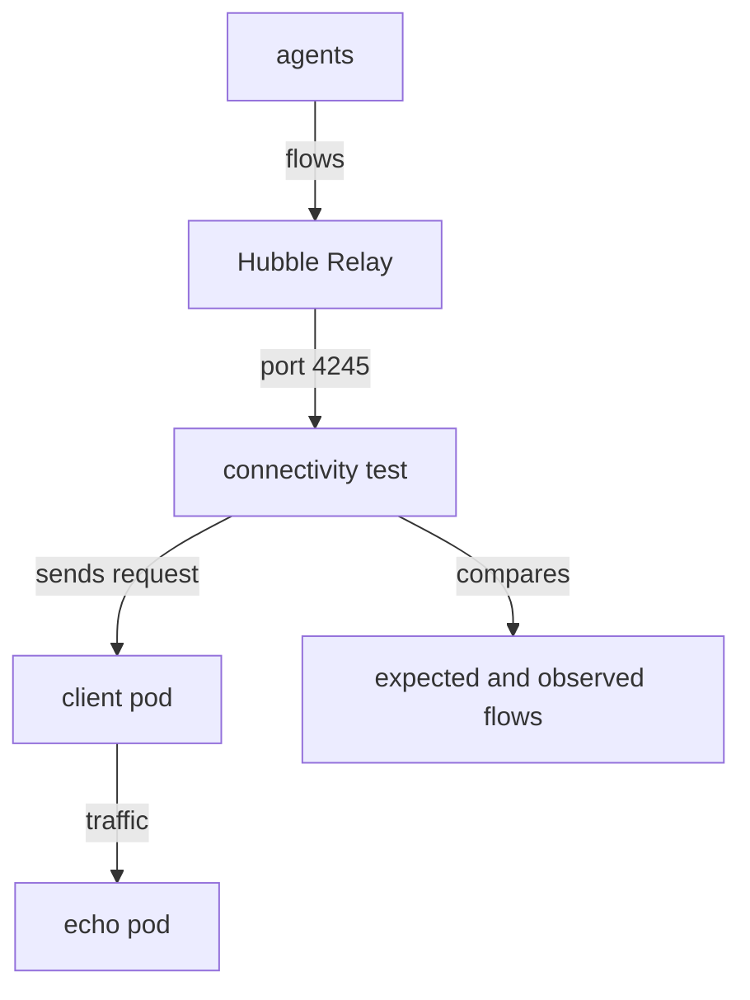

# Flow Validation And Failures

A request that returns the right answer does not prove that Cilium handled it. The packet might have taken another path, or a policy decision might have been different from what the scenario assumes. The connectivity test therefore asks Hubble, the observability layer of Cilium, for the flow records of its own requests and compares them with what it expects. This part explains that check, the options that control it, and the steps to take when a scenario fails.

## What a flow is

A flow is a record that Cilium makes for a network event: a connection attempt, a packet that was forwarded, or a packet that was dropped. Each flow names the source and the destination, the verdict (forwarded, dropped or another result), and details such as the protocol and the port. The agent on each node produces the flows of the pods on that node. Hubble is the part of Cilium that exposes them.

Hubble Relay is a Deployment that connects to the agents of all nodes and offers their flows through one endpoint. The default port of the relay is 4245. A client that wants to read the flows of the whole cluster talks to the relay, and the relay asks the agents.



The diagram shows two paths. The traffic goes from the client pod to the echo pod. The flow records go from the agents through Hubble Relay back to the tool, which compares them with the flows that the scenario expects.

## Flow validation in the test

By default, the connectivity test uses Hubble. The flag `--hubble` is on by default, and it makes the tool look for the flows of its own requests. The address of the Hubble endpoint is set by `--hubble-server`, and the default is `localhost:4245`. This means that the tool expects the relay to be reachable on your machine at that address. If the address is not reachable, the comparison cannot run and the tool reports it. The command `cilium hubble port-forward`, which runs in a second terminal, forwards the relay port to your machine.

The flag `--flow-validation` decides what happens with the result of the comparison. It takes three values:

- `disabled` turns the comparison off. No flow is read, and only the result of the requests counts.
- `warning` runs the comparison and prints a warning when a flow is missing or different. The scenario still passes if the request worked. This is the default.
- `strict` fails the scenario when the observed flows do not match the expectation.

Run a scoped test with each value and compare the results in the playground, which has Hubble Relay:

<!-- astrona:playground:renew -->

```sh
cilium connectivity test --single-node --test pod-to-pod --flow-validation strict
cilium connectivity test --single-node --test pod-to-pod --flow-validation disabled
```

Use `strict` when you want proof that the traffic went through Cilium, for example after an upgrade. Use `disabled` on a cluster without Hubble, or when the relay cannot be reached and you only want the result of the requests. A cluster without Hubble Relay and with the default `warning` shows the warnings in every scenario. That is the reason the labs of this module install the relay.

Two flags show what the tool compares. `--print-flows` prints the flows of each scenario, and `--all-flows` prints all of them, including the ones that the scenario ignores. Both make long output. Use them on a single scenario, for example together with `--test pod-to-pod`.

## When a scenario fails

A failure has a pattern, and a short sequence of steps finds its cause. First, read the failure message. It names the scenario, the source pod, the destination and the action. A timeout means that no answer arrived. A connection refused means that the destination host answered and that no process listened. A flow warning means that the request worked and that the flow record did not match.

Second, check the installation itself. A broken installation breaks every scenario at once:

```sh
cilium status --wait
kubectl -n kube-system get pods -o wide
```

Third, run only the failing scenario with more detail, and keep the output:

```sh
cilium connectivity test --single-node --test pod-to-pod --verbose --print-flows --timestamp > run.log 2>&1
```

The flow lines show the verdict of every packet. A `DROPPED` verdict with a reason such as a policy denial or a missing identity tells you which part of Cilium dropped the packet. A request with no flow at all can mean that no agent saw it, and that points to the path between the pods.

Two flags help when you must look at the cluster while the failure is fresh. `--pause-on-fail` or `-p` pauses the run at the first failure, so the test pods exist and you can run `kubectl exec` in them. `--collect-sysdump-on-failure` collects a sysdump when a scenario fails, with the same content as `cilium sysdump`, so the evidence is saved before anything changes. Both change the cost of the run, so use them on purpose.

## Cleaning up

After the investigation, remove the test resources. The cleanup command does not run any scenario. Add `--test-namespace` with the prefix that the run used if you set one. This command removes the default namespace:

```sh
cilium connectivity test --cleanup
```

If a later run behaves strangely, for example because a test image changed, add `--force-deploy` to redeploy the test workloads instead of reusing the old ones. A run that was interrupted can leave the namespace in place, and the cleanup removes it.

## A failure that is not a Cilium fault

Before you open a support case, rule out the usual outside causes. Test images that cannot be pulled stop the run before any scenario. A cluster with no internet access fails the scenarios that reach public targets, and `--test '!pod-to-world'` leaves them out. An admission policy that blocks the privileged or hostNetwork test pods fails the deployment step, and the tool prints the rejection. A node firewall that blocks the tunnel port between nodes fails every scenario that crosses nodes, and it passes `--single-node` runs. If the same scenario passes on a single node and fails across nodes, look at the node-to-node path, not at policies.

## What you know

You can now explain what flow validation proves, choose between `disabled`, `warning` and `strict`, read a failure in a structured way, collect evidence at the moment of the failure and remove the test resources. You know that a pass of the requests and a pass of the flow check are two different results.

## Common pitfalls

> [!WARNING]
> - **Ignoring the Hubble warnings.** The default `warning` lets a scenario pass while the flow check disagrees. Use `strict` when the proof matters.
> - **Disabling flow validation to make a test pass.** The run then proves less. Fix the access to Hubble Relay instead.
> - **Printing all flows on a full run.** The output is very large. Use `--print-flows` on one scenario.
> - **Cleaning up before you collect evidence.** The test pods and their state are gone after the cleanup.
> - **Calling a cross-node failure a policy problem.** Compare a single-node run with a multi-node run first.
