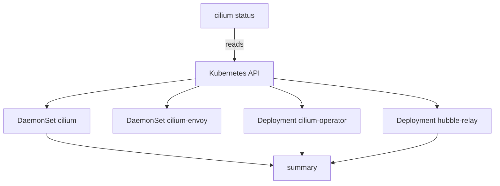

# Reading cilium status

The command `cilium status` is the first command to run when something about Cilium looks wrong, and the last one to run after a fix. It is fast, it needs no access to a node, and it covers every component. Because it is so common, it is worth knowing exactly what it reads, what its output means and how its exit code behaves. A wrong assumption about the exit code is the most common mistake in scripts that use it.

## What the command reads

The command reads Kubernetes objects through the API server. It looks at the DaemonSet `cilium`, the DaemonSet `cilium-envoy`, the Deployment `cilium-operator` and, if they exist, the Deployment `hubble-relay` and the Deployment of the Hubble user interface. It reads their status fields and the status of the pods that belong to them. It also reads the container states and the image versions of the pods.

The command does not open a connection to an agent for this. It trusts the readiness that Kubernetes reports. The readiness of an agent pod comes from the probes of the pod: the agent exposes a health endpoint, and the kubelet calls it. A pod is ready when the probe passes. The command therefore tells you what Kubernetes knows. For what the agent knows, you ask the agent itself with `cilium-dbg`.

## The summary output

The default output is a summary. It has three blocks. The first block has one line for each component, such as Cilium, the operator, the Envoy DaemonSet and Hubble Relay. Each line ends with a state: a word for a healthy component, a word for a disabled one, and an error or warning text for a component with a problem. The second block has one line for each workload, with the desired, ready and available counts. The third block shows the container states, the image versions of the components and, at the end, the errors and warnings that the command found.



The diagram shows that the tool reads workload objects from the API server and builds the summary from them. It does not ask the agents.

Run it in the playground:

<!-- astrona:playground:renew -->

```sh
cilium status
```

Read the report from the top. Each component line should show a healthy state. In the workload block, compare the counts: the desired count is how many pods the workload object wants, and the ready count is how many report ready. A difference is a problem even when the line above it looks calm. The block of image versions is useful after an upgrade: all pods of one component should show the same version, except for a short time during a rollout.

The text of the output changes between releases. Do not parse it with `grep` in a script. Use the JSON output for that.

## Other output formats

The flag `-o` or `--output` selects the format. The values are `summary` and `json`. The JSON output has the same facts in a structure, which a script can read with `jq` or a similar tool:

```sh
cilium status -o json
```

Use the JSON output when a script must decide, for example in a pipeline step that waits for a rollout. Read the fields instead of the text. The flag `--verbose` adds more detail to the messages about errors and logs, and helps when the summary says that something is wrong and does not say what:

```sh
cilium status --verbose
```

## Waiting with --wait

Without any flag, `cilium status` prints the state at this moment and ends. With `--wait`, it checks again and again until the status has no errors and no warnings, then it ends successfully. If the time limit comes first, the command ends with an error. The limit is set by `--wait-duration`, and its default is five minutes:

```sh
cilium status --wait --wait-duration 2m
```

This is the right command after an installation, an upgrade or a configuration change. The output refreshes while you wait. That behaviour comes from the option `--interactive`, which is on by default; switch it off with `--interactive=false` when the output goes to a log file, so you do not fill the log with refreshes.

The flag `--ignore-warnings` lets the wait end when the status has warnings but no errors. Use it when you know a warning is acceptable, for example when a second operator replica cannot be scheduled on a cluster with one node. Do not use it to make a pipeline green.

## The exit code

A plain `cilium status` ends with a non-zero exit code only when it cannot collect the status, for example when it cannot reach the cluster. It does not end with a failure because a component is unhealthy. A script that runs `cilium status` and checks `$?` therefore gets a zero for a cluster in which the agents are not ready.

```sh
cilium status
echo $?
```

For a decision in a script, use `cilium status --wait`. Its exit code is non-zero when the wait runs out with errors or warnings still present. That is the behaviour that a pipeline needs. Combine it with a short `--wait-duration` so a broken cluster fails the step quickly.

## Errors and warnings

The tool classifies its findings. An error means that a component does not work, for example no ready agent pod on a node. A warning means that something is not as expected and may be fine, for example that a Deployment has fewer ready replicas than desired during a rollout. The distinction decides what `--wait` waits for. Both stop `--wait` from ending, and `--ignore-warnings` removes only the warnings from that decision.

Read the text of the error. It names the workload and often the reason: a missing pod, a pod that is not ready, or an image that fails to pull. The next step is then a `kubectl` command on that workload.

## What you know and what is open

You can now say what `cilium status` reads, read its summary, choose between the summary and JSON, wait for a good state, and avoid the exit code mistake. The open question is what to do when a line shows a problem: how to go from the line to the workload and to the agent that holds the details.

## Common pitfalls

> [!WARNING]
> - **Trusting the exit code of a plain `cilium status`.** It ends with zero for an unhealthy cluster. Use `--wait` for a decision.
> - **Parsing the summary text in a script.** The text changes between releases. Use `-o json`.
> - **Reading only the component lines.** A workload line with fewer ready pods than desired is a problem even when the component line looks calm.
> - **Using `--ignore-warnings` by habit.** It hides the warnings that you have not understood.
> - **Leaving the refreshing output on in a log.** Use `--interactive=false` when the output is written to a file.
