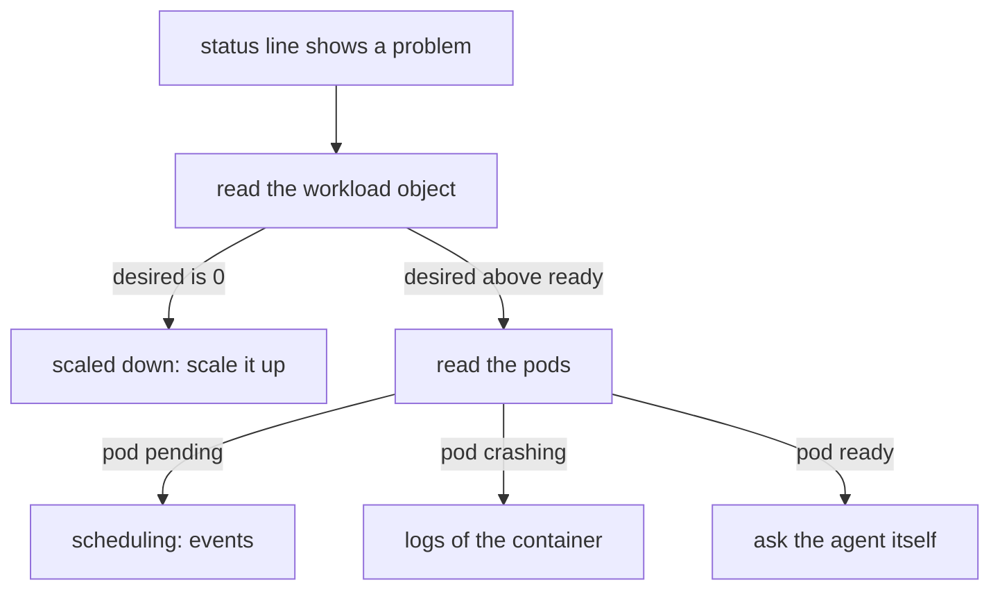

# Agent Status And Workload Health

A line in `cilium status` tells you which component is unhealthy. It does not tell you why. To find the reason you go one level down: from the component line to the workload object, then to the pods, and for the agent to the agent's own view of itself. This part shows each step and ends with the repair of a component that has no running replicas.

## From a component line to a workload

Each component in the report maps to one Kubernetes object in the namespace `kube-system`:

| Component line | Workload object | Kind |
| --- | --- | --- |
| Cilium | `cilium` | DaemonSet |
| Cilium Envoy | `cilium-envoy` | DaemonSet |
| Cilium Operator | `cilium-operator` | Deployment |
| Hubble Relay | `hubble-relay` | Deployment |

A DaemonSet runs one pod on each eligible node, so its desired count follows the number of nodes. A Deployment runs the number of replicas that its `spec.replicas` field says. This difference matters for repair. A DaemonSet cannot be scaled with `kubectl scale`, because it has no replica count. A Deployment can, and a Deployment scaled to zero is a valid, quiet state: no pods exist, so nothing crashes, and the status reports that no replica is available.



## Reading the workload objects

Start with the rollout state of the workload. It prints one line and has a useful exit code:

<!-- astrona:playground:renew -->

```sh
kubectl -n kube-system rollout status ds/cilium --timeout=60s
kubectl -n kube-system rollout status deploy/cilium-operator --timeout=60s
```

The command waits until the rollout is complete or the timeout passes. A Deployment with zero replicas counts as complete in this check, because nothing is missing from the desired state. For that reason, read the counts too:

```sh
kubectl -n kube-system get ds cilium cilium-envoy
kubectl -n kube-system get deploy cilium-operator hubble-relay
```

The columns that matter are the desired and ready counts. For a Deployment, the column `READY` shows ready over desired. Desired `0` means somebody scaled it down, or a configuration tool set it. Desired above ready means pods exist and do not become ready, or cannot be scheduled.

## Reading the pods

When the counts differ, list the pods of the component and read their state. The agents carry the label `k8s-app=cilium`:

```sh
kubectl -n kube-system get pods -l k8s-app=cilium -o wide
```

The `-o wide` option adds the node of each pod, so you can see which node has no healthy agent. A pod in `Pending` has not been scheduled; the events of the pod give the reason. A pod in `CrashLoopBackOff` starts and stops; the logs give the reason. A pod that is running and not ready has failed its readiness probe.

```sh
kubectl -n kube-system describe pod <pod-name>
kubectl -n kube-system logs <pod-name> --previous
```

The option `--previous` shows the log of the last stopped container, which is what you need for a crash loop. For an agent, the first lines of the log often show the setting that the agent could not apply.

## Asking one agent for its status

The report of `cilium status` comes from Kubernetes. The agent has its own report. It is available through the `cilium-dbg` tool that runs inside the agent container:

```sh
kubectl -n kube-system exec ds/cilium -- cilium-dbg status --verbose
```

With `ds/cilium`, `kubectl` picks one pod of the DaemonSet. The output covers the agent's own view: the state of the Kubernetes connection, the IP address management, the controllers, the proxy, and the encryption and routing settings. If one section says it failed, that is the agent's component that needs attention. To ask a specific node, name the pod instead of the DaemonSet.

The option `--all-controllers` of `cilium-dbg status` lists every internal controller with its failure count. Use it when the summary says that some controllers failed.

## Features that are enabled

The command `cilium features status` reports which features are enabled and which agent or operator setting each one uses. It is helpful after a change, to confirm that a feature is on in the agent that runs now:

```sh
cilium features status
```

The command supports `-o tab`, `-o markdown` and `-o json`, and the option `--output-file` to save the result. It reads the configuration through the agents, so it needs agents that run. Use it as a record of the state before and after an upgrade.

## Repairing a component with no replicas

A common failure is a Deployment that has been scaled to zero. The status reports the component as unavailable, `kubectl get deploy` shows `0/0`, and no pod exists to inspect. The repair is to set the replica count again:

Note the desired count first: the chart default for the operator is two replicas, and the playground installation uses one. Then apply it:

```sh
kubectl -n kube-system scale deploy/cilium-operator --replicas=1
kubectl -n kube-system scale deploy/hubble-relay --replicas=1
```

Then check the result:

```sh
cilium status --wait --wait-duration 2m
```

This repair changes the live object and not the Helm values. If the replica count came from a Helm value, a later `helm upgrade` or `cilium upgrade` can bring back the value in the release. Decide which side holds the truth and keep both the same.

## Operator, Envoy and relay

Each of the other components has its own role in the picture.

- **The operator** does the cluster-wide work that no single agent can do, such as IP address allocation for the cluster-pool mode and the cleanup of stale objects. When it is down, existing traffic continues, but new allocations and cleanup stop. Pods that start on a new node can then wait for their address.
- **Envoy** runs the layer 7 proxy that the agent uses for rules on HTTP and for some load balancing. In this version, Envoy runs as its own DaemonSet, so a failed Envoy pod shows in its own line.
- **Hubble Relay** collects the flows of all agents and offers them at one address. When it is down, the agents still collect flows locally, but you cannot see them for the whole cluster.

A failed component has an effect that matches its role. The effect is a clue for choosing where to look first.

## What you know and what is open

You can now go from a status line to the workload, the pods and the agent, and repair a Deployment that has no replicas. The next question is how to look into the traffic with Hubble and what evidence to keep when a problem remains.

## Common pitfalls

> [!WARNING]
> - **Running `kubectl scale` on a DaemonSet.** A DaemonSet has no replica count. Fix the nodes, the taints or the pod itself.
> - **Reading a successful `rollout status` as healthy.** A Deployment with zero replicas passes. Read the desired and ready counts too.
> - **Asking only one agent.** `ds/cilium` selects one pod. A problem on another node needs that node's pod.
> - **Fixing the live object and leaving the Helm values different.** A later upgrade can bring the old value back.
> - **Skipping the logs of the previous container.** For a crash loop the current container has often no useful lines yet.
