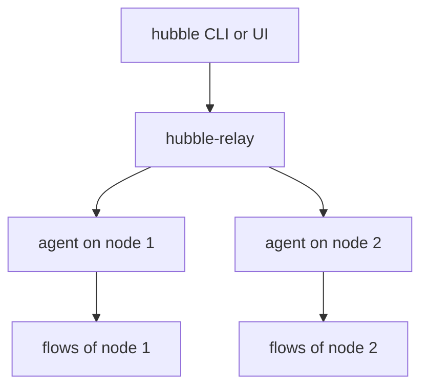

# Hubble, Relay And Evidence

Status tells you whether the components run. Hubble tells you what the network does: which workload talked to which, and whether a policy allowed or dropped the traffic. The Cilium command-line tool can switch Hubble on and off, and can open the path to the relay. When a problem stays unsolved, a sysdump collects the evidence for others to read. This part covers these three tasks and ends with a way of deciding where to look.

## What Hubble is made of

Hubble has three layers. Each agent has a Hubble server built in, which records the flows that pass through that node. The relay is a Deployment that connects to all the agent servers and presents their flows at one address. The optional user interface and the `hubble` command-line tool are clients. A client asks the relay, and the relay asks the agents.



Because the flows are held in memory on each node, and the buffer has a fixed size, old flows are overwritten. A flow that happened long ago can be gone.

## Turning Hubble on and off

The command `cilium hubble enable` turns Hubble on in an existing installation. It changes the installation through Helm values, so the change belongs to the release and not only to the live objects:

<!-- astrona:playground:renew -->

```sh
cilium hubble enable
```

The option `--relay` also deploys the relay, and `--ui` deploys the user interface. The playground already has the relay, so running the command there only confirms the state. The matching command `cilium hubble disable` turns it off again. The agents restart when the setting changes the agent configuration, so wait for the status after the command:

```sh
cilium status --wait --wait-duration 2m
```

Hubble settings that you change with `cilium config set` change only the ConfigMap, as described for configuration changes. A change made with `cilium hubble enable` goes through the release, which is why it is the better route for a lasting change.

## Reaching the relay

The relay service is only inside the cluster. To use the `hubble` tool or the interface from your machine, forward a local port to it:

```sh
cilium hubble port-forward
```

The command runs in the foreground and keeps the forward open until you stop it. Leave it in one terminal and use another terminal for the client. The default local port is 4245, and the `hubble` tool uses that address by default, so no extra option is needed:

```sh
hubble status
hubble observe --last 20
```

If the `hubble` tool is not installed, you can still confirm that the relay is up with `cilium status`, which shows the relay line. The connectivity test uses the same forward, which is why its `--hubble-server` option has the default `localhost:4245`.

## What a flow shows

The command `hubble observe` lists flows. Each flow has a source and a destination with namespace and pod, the verdict, and the protocol details. The verdict is the part that matters most for troubleshooting. `FORWARDED` means that the traffic was allowed. `DROPPED` means that a policy or an error stopped it. You can filter by namespace, pod, verdict and port. For example, to see what the example application receives:

```sh
hubble observe --namespace starfleet --last 20
```

Use these views to answer a question such as "does the probe reach the shuttle?" without logging into a pod. The output depends on traffic that has actually happened, so generate a request first, or the list may be empty.

## Collecting a sysdump

When you cannot solve a problem at once, or when someone else must read the state, collect a sysdump. The command gathers the Cilium and cluster information into one archive:

```sh
cilium sysdump
```

It collects logs, the status of the agents, the Kubernetes objects of the installation, the Cilium configuration and, if the relay is reachable, a number of recent flows. This can take a while on a large cluster. Useful options:

- `--quick` skips the heavier collections, for a fast result.
- `--output-filename` sets the name of the archive, without the extension.
- `--logs-since-time` limits how far back the logs go. The default is a long period, so on a busy cluster, set a shorter one.
- `--hubble-flows-count` sets how many flows are collected. The default is 10000.

A sysdump can contain details of your cluster, such as object names, node addresses and log lines. Check who may receive the archive before you send it. The connectivity test can also create one when a test fails, with `--collect-sysdump-on-failure`.

## A way to decide where to look

When something is wrong, use a fixed order of questions. It keeps you from reading logs before you know which component is at fault.

1. Run `cilium status --wait --wait-duration 1m`. If it passes, the installation is healthy and the problem is more likely in a policy, an application or the network outside the cluster.
2. If it fails, read which line fails. Read the desired and ready counts of that workload with `kubectl`.
3. Desired is zero: scale the Deployment up. Pods are pending: read the events. Pods crash: read the previous logs.
4. If the pods are ready and the problem remains, ask the agent with `cilium-dbg status --verbose`.
5. If the question is about traffic, read the flows with `hubble observe` and look at the verdicts.
6. If the cause is still open, collect a sysdump before you change more things, so the evidence is kept.

Each step uses the output of the one before it. Skipping to the last step makes the archive large and the diagnosis slow.

## What you know and what is open

You can enable and disable Hubble, reach the relay from your machine, read flows, collect a sysdump and follow an order of questions for a failure. The remaining step is practice: the graded exercise breaks two components, and you find and repair them with these tools.

## Common pitfalls

> [!WARNING]
> - **Closing the terminal of `cilium hubble port-forward`.** The forward ends with the command. Keep it running while you use the client.
> - **Reading an empty `hubble observe` as no traffic.** Flows are held in a limited buffer and only exist for traffic that happened. Generate a request and look again.
> - **Sending a sysdump without a check.** It can contain object names, addresses and logs.
> - **Changing things before collecting evidence.** A restart clears the state that you wanted to examine.
> - **Using `cilium config set` for a lasting Hubble change.** It changes the ConfigMap only. Use `cilium hubble enable` or Helm values.
