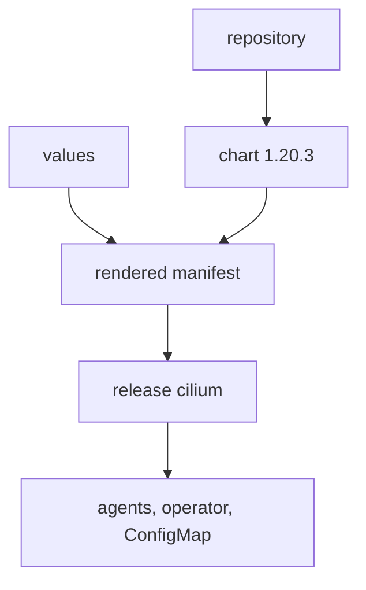

# Repository, Chart And Release

Helm packages Kubernetes manifests as a chart. A chart is a folder of templates and default values. When you install a chart, Helm renders the templates with your values, applies the result and records it as a release. This part follows the three words for Cilium: the repository that holds the chart, the chart itself and the release in your cluster.

## The repository

Cilium publishes its chart in a Helm repository. Add it and refresh the local index:

<!-- astrona:playground:renew -->

```sh
helm repo add cilium https://helm.cilium.io/
helm repo update
```

List the versions that the repository offers:

```sh
helm search repo cilium/cilium --versions | head
```

The chart version of Cilium equals the Cilium version, so chart 1.20.3 installs Cilium 1.20.3. Always state the version. Without `--version`, Helm installs the newest chart, and the result changes from week to week.

## The install command

The plain installation has one command. The release name is `cilium` and the namespace is `kube-system`:

```sh
helm install cilium cilium/cilium --version 1.20.3 --namespace kube-system
```

Both names matter. The Cilium command-line tool and the documentation look for a release named `cilium` in `kube-system`. The playground already did this step. Read the release it made:

```sh
helm list -n kube-system
helm status cilium -n kube-system
```

The `helm list` output has the revision, the status, the chart name with version and the application version.

## What the chart creates

Helm created the workloads and their configuration. Ask for the manifest it stored:

```sh
helm get manifest cilium -n kube-system | grep -E '^kind: (DaemonSet|Deployment|ConfigMap)' -A3 | grep -E 'kind:|name:'
```

The release owns these main objects: the DaemonSet `cilium` (the agents), the DaemonSet `cilium-envoy` (the Envoy proxy on every node), the Deployment `cilium-operator`, the ConfigMap `cilium-config` with the agent settings, service accounts and cluster roles. When Hubble Relay is enabled, the Deployment `hubble-relay` and the secrets for its certificates come with it.

The chart does not create the custom resource definitions (CRDs) of Cilium. The operator registers them when it starts, and the agents wait for them. This is the reason why `helm uninstall` later leaves the CRDs behind.



The diagram shows that the release stores the rendered manifest, and the workloads come from that manifest.

## Where Helm keeps the release

Helm stores each revision as a Secret of the type `helm.sh/release.v1` in the release namespace. The name has the form `sh.helm.release.v1.cilium.v1`, with the revision number at the end:

```sh
kubectl -n kube-system get secrets -l owner=helm
```

This is the history. If you delete these secrets, the workloads keep running, but Helm forgets the release, and a later `helm upgrade` fails or creates a second copy.

## What you know and what is open

You can now add the repository, choose a version, install and read the release. The open question is where the values come from, because the release is only as good as the values that you gave it.

## Common pitfalls

> [!WARNING]
> - **Installing without `--version`.** The result depends on the day that you run the command.
> - **Using another release name or namespace.** The command-line tool and the guides expect `cilium` in `kube-system`.
> - **Deleting the release secrets.** The workloads stay, but Helm loses its history.
> - **Expecting CRDs from the chart.** The operator creates them.
