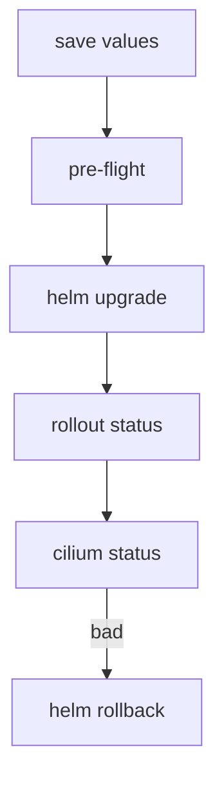

# Upgrade, History And Rollback

An upgrade of the network plugin changes the component that every pod depends on. The risk is low when you follow an order and know the way back. This part gives the order for a Cilium upgrade with Helm, the evidence that it worked and the use of Helm history when it did not.

## Before the upgrade

Read the upgrade notes of the target version, because they list values that changed names and behaviour that changed. Upgrade one minor version at a time, for example from 1.19 to 1.20 and not from 1.18 to 1.20. Check that the cluster is healthy first:

<!-- astrona:playground:renew -->

```sh
cilium status --wait
helm get values cilium -n kube-system -o yaml > values-before-upgrade.yaml
```

The Cilium project also publishes a pre-flight chart. It runs a copy of the agent next to the real ones and checks that the new version can read the existing state. Install it with the target version and no agent and no operator:

```sh
helm install cilium-preflight cilium/cilium --version 1.20.3 --namespace kube-system --set preflight.enabled=true --set agent=false --set operator.enabled=false
```

Wait until its pods are ready, then remove it with `helm uninstall cilium-preflight -n kube-system`. This step prevents the case in which an agent of the new version cannot start on the old state of a node.

## The upgrade

Run the upgrade with the saved values and the target version:

```sh
helm upgrade cilium cilium/cilium --version 1.20.3 --namespace kube-system -f values-before-upgrade.yaml --set upgradeCompatibility=1.19
```

The value `upgradeCompatibility` takes the version that you started from. It tells the chart to keep behaviour that is compatible with that version, so that a new default does not change the datapath while the nodes roll. Use the value that the upgrade notes of your target version name.

Helm updates the objects. The DaemonSet replaces the agent pods node by node, and the Deployment replaces the operator. Watch the rollout:

```sh
kubectl -n kube-system rollout status daemonset/cilium --timeout=300s
kubectl -n kube-system rollout status deployment/cilium-operator --timeout=300s
cilium status --wait
```

During the rollout, nodes briefly run different versions. Cilium supports that for neighbouring minor versions, and that is the reason for the one-minor-at-a-time rule.

## Proving that it worked

An upgrade worked when four things are true. The release is `deployed` at the new revision. All agent pods run the new image. `cilium status` has no errors. And a real connection between the example pods works. Check them:

```sh
helm history cilium -n kube-system
kubectl -n kube-system get pods -l k8s-app=cilium -o jsonpath='{.items[*].spec.containers[0].image}'
cilium connectivity test --test pod-to-pod
```

## History and rollback

Every upgrade creates a revision. `helm history` lists them with their status and a description:

```sh
helm history cilium -n kube-system
```

If the new revision is bad, return to the last good one:

```sh
helm rollback cilium 1 -n kube-system
```

The rollback creates a new revision that has the content of revision 1. It re-applies the manifest, so the agents restart. It does not undo changes that the new version made to its stored state on the nodes, and it does not undo a CRD that the operator updated. For that reason, the pre-flight step comes before the upgrade and not after it.



The diagram shows the order, and the rollback as the path out of a failed check.

## What you know and what is open

You can now upgrade in a safe order, prove the result and return to an earlier revision. The open question is how the Cilium command-line tool fits in, because it also installs and upgrades.

## Common pitfalls

> [!WARNING]
> - **Skipping a minor version.** Neighbouring versions are the supported path.
> - **Upgrading without a saved values file.** You cannot reproduce the old state if the upgrade goes wrong.
> - **Treating rollback as a full undo.** It restores the manifest, not every change to node state.
> - **Declaring success from `helm upgrade` alone.** The command returns when objects are applied. Wait for the rollout and run `cilium status --wait`.
