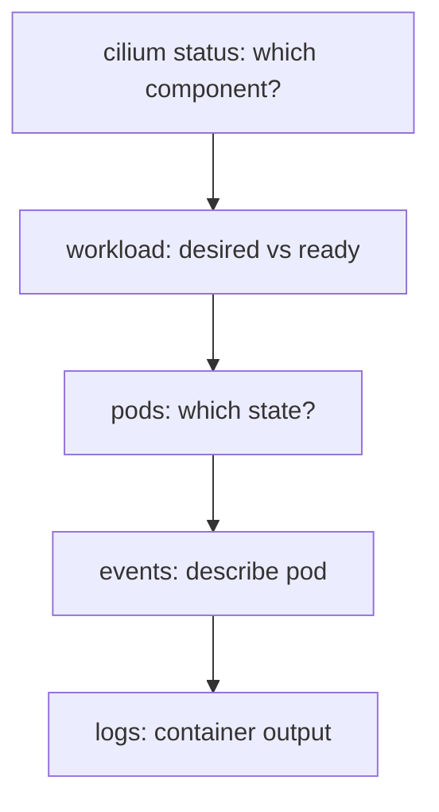

# Reading The Failure

When a Cilium installation does not work, the first mistake is to look in the wrong place. The error that you see, such as a pod stuck in `ContainerCreating`, belongs to the application, while the cause belongs to Cilium. This part gives a fixed order of commands. Each command answers one question and tells you which command to run next.

## The order of questions

Start at the top and stop at the first command that shows a problem.

1. Does `cilium status` show a component with an error or with fewer ready pods than desired? This names the component.
2. Does the workload object of that component show the desired pod count? A Deployment scaled to zero or a DaemonSet with no eligible node explains missing pods.
3. What state are the pods in? `Pending` means scheduling. `ImagePullBackOff` or `ErrImagePull` means the image. `CrashLoopBackOff` means the process starts and stops. `Running` but not ready means the readiness probe fails.
4. What do the events of the pod say? Events are the messages that Kubernetes records about a pod, such as a failed image pull.
5. What do the logs of the container say? The logs come from the process itself and give the real reason for a crash.



The diagram shows that each step is more specific than the one before. Do not run the last step first: the logs of an agent are long and only make sense once you know which pod to read.

## Running the first steps

Run the commands in the playground while it is healthy, so you know what normal looks like:

<!-- astrona:playground:renew -->

```sh
cilium status
kubectl -n kube-system get daemonset cilium
kubectl -n kube-system get pods -l k8s-app=cilium -o wide
```

The first command gives the component view. The second shows the desired, current and ready counts of the agent DaemonSet. The third lists the agent pods with the node of each. A healthy two-node cluster shows two agent pods, one per node, both ready.

Then read the events and the logs of one agent pod:

```sh
kubectl -n kube-system describe pod <agent pod>
kubectl -n kube-system logs <agent pod> -c cilium-agent --tail=50
```

In `describe`, go straight to the `Events` section at the end. In the logs, look for lines with the level `error` or `warning`. The flag `--tail` limits the output to the last lines, which is where a current problem appears.

## Labels that select the right pods

You select Cilium pods by label, not by name, because the names change. The agent pods carry `k8s-app=cilium`. The operator pods carry `io.cilium/app=operator`. The relay pods carry `k8s-app=hubble-relay`. With these labels, one command reads all pods of a component:

```sh
kubectl -n kube-system get pods -l io.cilium/app=operator
kubectl -n kube-system logs -l io.cilium/app=operator --tail=30
```

## Previous logs of a crashing container

A container in `CrashLoopBackOff` restarts, and the logs of the new container are often empty or short. The flag `--previous` reads the logs of the container instance that crashed:

```sh
kubectl -n kube-system logs <agent pod> -c cilium-agent --previous
```

This is the command that shows the last words of a process before it exits.

## What you know and what is open

You can now follow the five questions and read events and logs by label. The open question is what the typical answers are when the agent pod does not start.

## Common pitfalls

> [!WARNING]
> - **Starting with the application pod.** The application shows the symptom. Start with `cilium status`.
> - **Reading logs before the pod state.** Know whether the container runs, crashes or never starts.
> - **Selecting pods by name.** Use labels. Names change at each restart of a workload.
> - **Forgetting `--previous`.** The current container of a crash loop may have no useful log.
