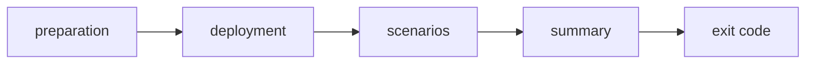

# Reading The Output Of A Run

A passing run is easy to read. A failing run prints a lot, and the line that matters can be hard to find. This part explains the phases of a run, how a failed scenario appears, what the summary counts and how the exit code works. The exact wording of the lines changes between versions of the tool, so the part describes the structure and not the text.

## The phases of a run

A run has four phases, in this order.

1. **Preparation.** The tool checks that it can reach the cluster, reads the Cilium version and the enabled features, and decides which scenarios apply. A scenario that needs a feature that is off is skipped.
2. **Deployment.** The tool creates the test namespace, the client and echo workloads and the Services, and waits until they are ready. Failures here are about images, admission rules or resources, not about Cilium connectivity.
3. **Scenarios.** The tool runs the selected scenarios one by one. Each scenario sends requests from client pods to targets and checks the results. With flow validation on, it also checks the flows.
4. **Summary.** The tool prints the number of scenarios, tests and actions that passed, failed or were skipped.



The diagram shows the order and where problems come from. A failure in the second box is an environment problem. A failure in the third box is a connectivity problem.

## Scenario, test and action

The output has three levels of detail. A scenario is a named family, such as pod to pod. A test is one case inside a scenario. An action is one request, for example one `curl` from one client pod to one target. A failed action prints its source, its destination and the command that failed, so you can repeat it by hand with `kubectl exec`.

When a scenario fails, read in this order: the name of the scenario, the failed action and its source and destination, and then the reason that the tool prints, such as a timeout or an unexpected status. A timeout often means a drop. A refused connection means that the packet arrived and nothing listened.

## The exit code

The command exits with zero when all selected scenarios pass, and with a non-zero code when a scenario or the deployment fails. A pipeline can therefore rely on the exit code of this command, unlike a plain `cilium status`. Skipped scenarios do not make a run fail, which is why you should read the summary as well: a run that skipped everything also exits with zero.

```sh
cilium connectivity test --single-node --test pod-to-pod
echo $?
```

## Keeping the output for later

Write the output to a file with a time stamp on each line. Use the error stream too, because the tool writes some messages to it:

```sh
cilium connectivity test --single-node --test pod-to-pod --timestamp > run.log 2>&1
```

Together with the JUnit report, the log is the record of the run. A log without a time stamp cannot be matched with the agent logs.

## What you know and what is open

You can now read the phases of a run, tell an environment failure from a connectivity failure and use the exit code. The open question is what to do with a failed action: how to see the packet and the reason it failed. That is the job of the monitor.

## Common pitfalls

> [!WARNING]
> - **Reading a deployment failure as a network failure.** Failures before the scenarios are about images, admission or resources.
> - **Trusting exit code zero without the summary.** A run that skipped the scenarios also exits with zero.
> - **Saving only standard output.** Redirect the error stream too.
> - **Keeping no time stamps.** You cannot match the run with the logs of the agents.
