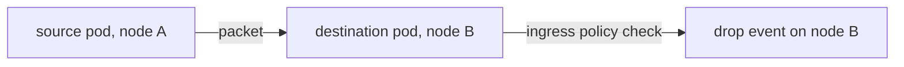

# Reading Drops And Policy Verdicts

A drop event is the most useful line the monitor prints. It names the reason, the two identities and the packet. This part explains the parts of a drop event, the common reasons, where a drop is reported and how to find the same event with Hubble. The exact text of the line varies between versions, so learn the fields, not the text.

## The fields of a drop event

Every drop line carries the same information, in this order of importance.

- **The reason.** A short text in the line, such as "Policy denied". The reason names the check that failed.
- **The identities.** The source identity and the destination identity, as numbers. They tell you which label sets were talking. Map them to labels with `cilium-dbg identity list`.
- **The endpoint.** The endpoint ID of the pod where the datapath dropped the packet.
- **The packet.** The source and destination address and port, the protocol, and for TCP the flags, such as SYN.
- **The direction and place.** Whether the drop happened on ingress or egress, and in which BPF program.

With the identities, you can answer the question "who was blocked from reaching whom" without reading any IP address. With the reason, you know which part of the system to look at.

## Common drop reasons

- **Policy denied.** A policy selects the destination (or the source, for egress) and no rule allows this source identity, port and protocol. Look at the policies in the namespace of the destination, and at `cilium-dbg policy get`.
- **Unsupported L3 protocol, invalid packet or similar parsing reasons.** The packet is malformed or uses something the datapath does not handle. These are rare in healthy traffic.
- **No tunnel or encryption key, or a missing route.** The datapath cannot send the packet to the other node. This points to the node-to-node setup, not to a policy.
- **Unknown or stale identity.** The agent has no identity for the source yet. It is common for a short time right after a pod starts.

The first reason is the one that matters most for the exam and for daily work. A request that times out, with a "Policy denied" drop at the destination, is a policy problem. The same timeout with no drop event is not a policy problem, and the search moves to routing, to the application or to the node.

## Where the drop is reported

The datapath makes the decision where the policy is enforced. For ingress policy, that is at the destination endpoint, so the drop is reported by the agent on the node of the destination pod. For egress policy, it is at the source endpoint, on the node of the source pod. If you run the monitor on the other node, you see nothing. This is why the earlier part says to start with the node of the destination.



## Policy verdict events

The type `policy-verdict` reports the decision for new connections, both allow and deny. It is a good fit when you want to confirm that a new rule allows traffic, because an allow is also visible. The drop type reports only the denials.

## The same data in Hubble

If Hubble is enabled, the same drop is a flow with the verdict `DROPPED`. The client `hubble observe` reads the flows of the whole cluster through the relay, so you do not have to find the node:

```sh
hubble observe --namespace starfleet --verdict DROPPED
```

Hubble shows the pod names instead of numbers and adds the namespace. The monitor shows the datapath of one node in more detail and needs no relay. Use Hubble first when it is on, and the monitor when it is off or when you need the BPF detail.

## From drop to fix

With the drop in hand, the repair follows the reason. For "Policy denied", find the NetworkPolicy or CiliumNetworkPolicy that selects the destination, and either add a rule for the source or remove the policy if it is wrong. After the change, repeat the request and check that the drop event no longer appears. A repair is proved by the request succeeding and the drop events stopping, not only by the policy object changing.

## What you know

You can now run the monitor, read a drop event field by field, tell policy drops from other drops, know on which node to look and find the same event in Hubble. This closes the path from a failed connectivity test to a cause.

## Common pitfalls

> [!WARNING]
> - **Reading IP addresses instead of identities.** The identities tell you which label sets were involved.
> - **Looking for an ingress drop on the source node.** It appears on the destination node.
> - **Assuming every timeout is a policy.** No drop event means the cause is elsewhere.
> - **Declaring the fix from the object alone.** Repeat the request and watch the drops stop.
